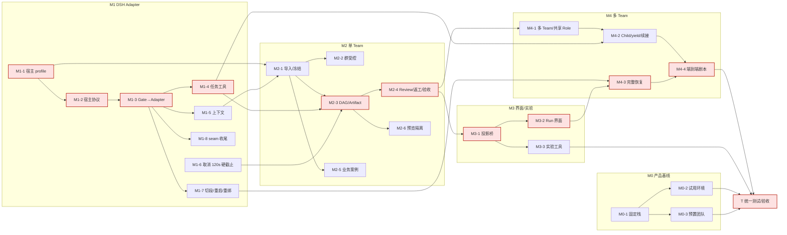

# DS Bot + Squad M0→M4 开发规划（2026-10-18）

> **只是规划，没有写代码。**
>
> **前提**：用户决定先把 M0 到 M4 全部开发完成（直到 M4 多 Team 协同能完整跑通），再统一做测试和验收。中间阶段只做最低限度的验证：能编译、单测能过。不再做 P0/P1 那样的负例测试轮。
>
> **依据**：
> - [`dsh_squad_case/MIGRATION_PLAN.md`](../dsh_squad_case/MIGRATION_PLAN.md)（M0–M4、TR-01～TR-18）
> - [`dsh_squad_case/ACCEPTANCE.md`](../dsh_squad_case/ACCEPTANCE.md)（28 项）
> - [P0/P1 报告](dsh-squad-p0-probe-report-2026-10-18.md)，尤其是 §9
> - `feat/dsh-p1-seam` 上的现有代码：`dsh_squad/`（ds-bot seam 补丁、Squad Gate）、`probes/`、`pi_squad/controller/`

## 0. 起点：已经有什么

| 组件 | 现状 | 对后续的意义 |
|---|---|---|
| Go Controller `pi_squad/controller/` | 约 1.1 万行非测试 Go：task 410、scheduler 4812、agent 921、httpapi 1105、project 1831 等。Stage04 的 Run/Task/Attempt、DAG、Review、Acceptance、FIFO、WaitGraph、continuation、recovery 都已实现，并在 Pi 上 89/89 通过 | M2 和 M4 的业务逻辑**大部分可以复用**，主要工作是换宿主、接适配器 |
| Controller 与 Pi 的耦合 | 集中在 `project/doctor.go`（`HostProfile = "pi-coding-agent/1.1.0"`）和 `project/probe.go`；协议头是 `X-Pi-Squad-*` | 需要抽象宿主 profile |
| 业务 120 秒硬截止 | `scheduler/dispatch.go:136` 仍有 `DeadlineAt = now + 120s`，到期后让祖先任务失败 | 2026-10-04 已决定取消，**必须改掉** |
| ds-bot seam 补丁 | 已提供：创建时归属、固定拦截点、resume/resend 开关、`dsBotSeam` 服务 | M1 适配器的地基 |
| Squad Gate | 已有准入判定、组合结束判定、冻结模型、tool guard、step 审计。`/api/squad-gate` 只是测试替身 | 要改造成真正的 DSH Adapter |
| 测试设施 | `probes/` 下有 bench、mock 驱动、探针；`drive-p1.mjs` 有 14 个受控负例 | 统一测试阶段直接复用 |

## 1. 工作包

工作量按「1 名开发者加 AI 辅助」的**人日**估算，误差约 ±40%，最终以实际为准。每个包的最低验证固定为：`go build ./... && go test ./...`、`dsh_squad/gate` 单测、`prepare-ds-bot.sh --test`；有界面的包再加一次手动打开页面。

### X：贯穿全程

| ID | 目标 | 产物 | 仓库 / 模块 | 依赖 | 人日 |
|---|---|---|---|---|---|
| X-1 | 一条命令完成构建和最低验证 | `dsh_squad/scripts/check.sh`：Go 构建与单测、Gate 单测、补丁应用并跑 ds-bot 单测；可选接入 GitHub Actions | 本仓库 | — | 1 |
| X-2 | 使用说明 | `dsh_squad/USAGE.md`：配置、启动、会话内命令和工具。AGENTS.md 要求的「能用的功能同步写进使用说明」照此执行 | 本仓库 | 随各包更新 | 0.5/里程碑 |
| X-3 | 凭据与权限分层 | Controller operator 凭据、runtime 凭据、浏览器 cookie 三者隔离的约定和实现 | Controller、Adapter | M1-3 | 1.5 |

### M0：完整的 DS Bot 产品基线

| ID | 目标 | 产物 | 仓库 / 模块 | 依赖 | 人日 |
|---|---|---|---|---|---|
| M0-1 | 固定可分发的栈 | 启动器：固定 DSH 0.2.1-rc.2 加打补丁的 ds-bot。M0 只用 Free 模式，Gate 默认不挂。提供 compose 或脚本，独立 `DSH_HOME` | `dsh_squad/deploy/` | — | 2 |
| M0-2 | 试用者环境 | 每位试用者一个独立宿主或数据域（端口、`DSH_HOME`、token 登录、可选 TLS），加开通和回收脚本 | `dsh_squad/deploy/` | M0-1、**D4** | 2 |
| M0-3 | 预置团队 | 自动创建 Chief、Researcher、Builder、Reviewer 四个 Bot（至少两个 Provider）、一个群聊、初始 Memory | `dsh_squad/deploy/provision.mjs`（经 `/api/bot`） | M0-1、**D7** | 1 |

M0 小计约 5 人日。

### M1：DSH Adapter（M2 的硬前置）

| ID | 目标 | 产物 | 仓库 / 模块 | 依赖 | 人日 |
|---|---|---|---|---|---|
| M1-1 | Controller 与宿主无关 | `hostprofile` 抽象，`pi-coding-agent/1.1.0` 和 `dsh/0.2.1-rc.2+ds-bot/<sha>` 两个 profile；doctor/probe 按 profile 分支；DSH 侧用独立 DB 和数据域 | `pi_squad/controller/project`（或新位置，**D1**） | **D1** | 3 |
| M1-2 | 宿主协议 | `squad/3`，或在 `pi-squad/2` 上加 host 字段（**D3**）。一个宿主进程内有多个 runtime：每个受控（Bot, 位置）各自注册、各自拿凭据，绑定 `binding_epoch`；导出 schema | Controller `httpapi/agent`、`protocol/` | M1-1、**D3** | 3 |
| M1-3 | Gate 变成 Adapter | 用 Controller 客户端替换测试路由，负责：注册和心跳；拉取派发（SSE 或轮询）；签发准入（`attempt_id`、`segment_id`、`fence`、`epoch`）；上报 AttemptEvent（opened、tool、result_proposed、settled、interrupted、`outcome_unknown`）。被扣留的输入持久化后交给 Controller（Q36） | `dsh_squad/gate` → `dsh_squad/adapter` | M1-2 | 6 |
| M1-4 | Bot 的正式任务工具 | 在受控会话里注册：提交结果（结构化）、yield/child、clarify、读当前任务。把 `pi_squad/extension/task-tools.ts` 的语义移植到 `ctx.tools.register`；只在活动 attempt 内可用 | `dsh_squad/adapter` | M1-3 | 4 |
| M1-5 | 上下文组装 | 受控会话的 role、team、task 段落（移植 `context-assembly.ts`），用 Agent 作用域的 `systemPrompt.section`；记录上下文 hash | `dsh_squad/adapter` | M1-3 | 2 |
| M1-6 | 取消业务硬截止 | 删掉 `dispatch.go` 的 120 秒 `DeadlineAt` 及其让祖先失败的逻辑；必要子任务明确回传之后才允许完成；通信 lease 保留 | Controller `scheduler/` | — | 1.5 |
| M1-7 | 切段、重启与重新绑定 | part 切换上报为 `binding_epoch+1`；重启后读持久日志对账，结果进 `outcome_unknown`；接通 operator 的 reconcile/rebind 入口 | Adapter、Controller `scheduler/recovery` | M1-3 | 3 |
| M1-8 | seam 补丁收尾 | 扣留队列持久化，rewake 稳定（Q37），兜底路径补齐（Q35）；按 **D2** 决定是否起草上游 PR | `dsh_squad/patches/ds-bot` | M1-3、**D2** | 2 |

M1 小计约 24.5 人日。

### M2：单 Team 真实交付

| ID | 目标 | 产物 | 仓库 / 模块 | 依赖 | 人日 |
|---|---|---|---|---|---|
| M2-1 | 配置导入与 Run 冻结 | 读 `.agents/pisquad/roles`、`team.json`、Workflow，生成 Role 到 Bot 的映射（缺的 Bot 自动创建）。Run 冻结模型、工具、上下文 hash 和 Memory 视图（**D12**） | Controller `project/`、Adapter | M1-1、M1-5 | 4 |
| M2-2 | 群聊受控模式 | 群设置 Managed 开关（一个群对应一个 Team，一个 Team 同时只有一个 active Run）。群里的用户消息分成通知、Run Guidance、修改、澄清，交给 Controller | Adapter、seam（群消息入口） | M1-3、M2-1 | 4 |
| M2-3 | DAG 派发与 Artifact | 按依赖和容量派发到 Bot；不可变 Artifact（`artifact_id`、`content_hash`、`result_revision`），存放位置由 **D8** 定 | Controller `scheduler/dispatch`、Adapter | M1-4、M2-1 | 4 |
| M2-4 | Review、返工、验收 | 独立 Reviewer 审查精确的结果版本；被拒时新增 rework 和 re-review 节点；Final Gate。主要复用 `scheduler/{reviews,acceptance,invalidation}` | Controller、Adapter | M2-3 | 3 |
| M2-5 | 业务案例 | 数学知识点：研究、课件实现、格式检查、教学审核、返工复审、交付。Team、Workflow、Role 模板（**D11**） | `dsh_squad/cases/` | M2-1 | 2 |
| M2-6 | 课件预览隔离 | 独立 origin 的 sandbox iframe，读不到 DS Bot 的 cookie 和控制接口 | ds-bot 客户端或独立页面（**D5**） | M2-3 | 2 |

M2 小计约 19 人日。

### M3：界面与对照实验

| ID | 目标 | 产物 | 仓库 / 模块 | 依赖 | 人日 |
|---|---|---|---|---|---|
| M3-1 | 投影桥 | Controller 的 Snapshot 和 Events 经宿主通道送到浏览器；SSE 断档就重新取快照；前端不自建状态机 | Adapter（宿主通道）、Controller `projection/` | M2-4 | 3 |
| M3-2 | Run 界面 | 启动 Run，展示 Task/DAG、等待、Artifact 预览、Review 和恢复卡片。「回答问题」「批准工具」「验收成果」分成三类按钮，都绑定 `expected_revision` | ds-bot 客户端（补丁或独立客户端插件，**D2**、**D5**） | M3-1 | 8 |
| M3-3 | 对照实验工具 | S、A、B、C（D 在 M4 之后）五组固定配置；指标采集（含辅助调用和被取消调用的成本，M8/M11）；报告生成 | `dsh_squad/experiments/`、复用 `probes/tokens.mjs` | M2-4、M3-1 | 5 |

M3 小计约 16 人日。

### M4：高级协同治理

| ID | 目标 | 产物 | 仓库 / 模块 | 依赖 | 人日 |
|---|---|---|---|---|---|
| M4-1 | 多 Team 与共享 Role | 一个 Bot 在多个群（多个 Team）各有一个受控会话，即同一 Bot 多个绑定；接通 Primary/Secondary、跨 Team 原子准入、FIFO（Go 已有） | Adapter、Controller `scheduler/{runs,waitgraph}` | M2-4 | 4 |
| M4-2 | Child、yield 与同一 Attempt 续接 | capacity=1 时父任务 yield 暂停，子任务回传后用新 segment 在原 attempt 内续接；必要子任务未完成时拒绝父任务完成 | Adapter（工具与注入）、Controller `continuation` | M1-4、M4-1 | 4 |
| M4-3 | 完整恢复 | cancel、reconcile、retry、rebind、resume 的 operator 流程；宿主或 Controller 崩溃；迟到结果审计；界面卡片 | Controller、Adapter、界面 | M1-7、M3-2 | 4 |
| M4-4 | 端到端剧本 | Team A、B 共享 Reviewer，Team C 独立；可脚本化地完整跑一遍，作为「M4 能跑通」的标志 | `dsh_squad/cases/m4/` | M4-1～M4-3 | 2 |

M4 小计约 14 人日。

### T：统一测试与验收

见 §4。约 10 人日；非开发用户试用的日历时间另计。

**合计**：约 93 人日（X 约 5、M0 5、M1 24.5、M2 19、M3 16、M4 14、T 10）。按 §2 的并行方式，关键路径约 60 人日。

## 2. 关键路径与执行顺序

**关键路径**（红色）：M1-1 → M1-2 → M1-3 → M1-4 → M2-3 → M2-4 → M3-1 → M3-2 → M4-3 → M4-4 → T，约 3+3+6+4+4+3+3+8+4+2+10 ≈ **50 人日**。加上 D1–D3 的等待和联调余量，约 60 人日。

**建议执行顺序**（同一行可并行）：

1. **第 1 周**：拍板 D1、D2、D3；M1-1、M1-6；X-1。M0-1 可以穿插在等待决策的间隙里做。
2. **第 2–3 周**：M1-2 → M1-3（最大的包）；收尾时并行做 M1-5、M1-8。
3. **第 4 周**：M1-4、M1-7；M2-1、M2-5（模板可以和代码同时写）。
4. **第 5–6 周**：M2-3 → M2-4；并行 M2-2、M2-6。如果 D6 选择提前试用，M0-2、M0-3 在这里完成，交给试用者。
5. **第 7–8 周**：M3-1 → M3-2；并行 M3-3。
6. **第 9–10 周**：M4-1 → M4-2；M4-3（依赖 M3-2 的卡片）；M4-4。
7. **第 11–12 周**：T 统一测试，修复，再回归一轮。

## 3. 需要用户拍板的决策点

| ID | 问题 | 选项 | 建议 | 影响 |
|---|---|---|---|---|
| **D1** | Go Controller 放在哪 | A. 留在 `pi_squad/controller`，加宿主 profile，Pi 和 DSH 共用一份；B. 复制到 `dsh_squad/controller` 后分开演进；C. 抽成独立的宿主无关模块，两边引用 | **A**：Stage04 的逻辑只有一份，不会分叉。代价是 Pi 那条路径也要能编译通过，PASS 记录仍然不继承 | M1-1 及后续所有 Controller 包 |
| **D2** | 是否继续用补丁改 ds-bot | A. 继续用补丁（seam 和界面都放补丁里）；B. 补丁只放 seam，界面做成独立的 DSH 客户端插件；C. 维护 ds-bot fork 分支；D. 先向上游提 seam PR | **B 加 D**：补丁已能覆盖 seam；M3 的界面估计数千行，放进补丁会难以维护。不建议 fork，上游迭代太快 | M1-8、M3-2；补丁规模 |
| **D3** | 宿主协议版本 | A. 新定义 `squad/3`（宿主中立）；B. 在 `pi-squad/2` 上加 host 字段 | **A**：多 runtime 同进程、epoch、扣留输入这些概念 v2 都没有；新旧数据不混跑 | M1-2、Adapter 客户端 |
| **D4** | 多租户与身份 | A. 每位试用者一个独立 DSH 宿主和数据域（计划里的默认做法）；B. 一个宿主多用户；C. 先只在开发者本机 | **A**：DS Bot 的单个 `DSH_HOME` 不是多租户设计。需要你定部署位置（本机、内网机器还是云主机）、访问方式（token 链接、反代 + TLS）、试用人数 | M0-2、X-3 |
| **D5** | 界面范围 | A. 最小：DS Bot 侧边栏里的 Run 卡片和任务列表；B. 完整：DAG 图、Artifact 预览、Review 和恢复卡片、实验报告页；C. 独立的 Web 控制台，不进 DS Bot | **先 A 再补成 B 的必需部分**（三类按钮、Artifact 预览、Review 卡），DAG 图放最后；C 偏离「同一界面」的目标 | M3-2 工作量（8 人日按 A 加部分 B 估算） |
| **D6** | M0 非开发用户试用怎么安排 | A. 现在就在 Free 模式下试用，和开发并行，只收集反馈，不等 Squad 功能；B. 按你的决定放到最后统一做 | **A**：M0 不依赖 M1–M4，早收集反馈风险最低；正式的 M0-01～04 判定仍在 T 阶段做 | M0-2、M0-3 的时间点；需要你找试用者 |
| **D7** | 真实模型 key 何时需要 | A. M0 预置团队时就要（至少两个 Provider）；B. 开发期全部用 mock，T 阶段才要；C. 每个里程碑结束时各用少量 key 冒烟一次 | **B 为主**：开发期 mock 就够。**T 阶段必须有**：至少两个 Provider（DeepSeek 加另一家），供 M0-02、M1-09、M3 对照实验使用；如果 D6 选 A，M0 试用时也要。还需要你给出预算上限 | T、M0 试用、M3-3 |
| **D8** | Artifact 存在哪 | A. DSH attachments（`saveFile`）；B. Controller 自己的 blob 目录，按内容 hash 寻址；C. 工作区里的文件加 hash | **B**：不可变、可审计，不依赖 DSH 内部存储 | M2-3、M2-6 |
| **D9** | 开发期间是否升级 DSH / DS Bot | A. 钉死 0.2.1-rc.2 和 `e13bc34`，到 T 前再升级一次；B. 跟着上游升级 | **A**：P1 的 rewake 依赖 rc.2 的行为（Q37） | 全部 |
| **D10** | 中间阶段是否保留现成的自动化回归 | A. 完全按你的决定，只编译加单测；B. 另外把已有的 `drive-p1.mjs`（mock，约 13 分钟，不花 token）当冒烟回归，每个里程碑结束时跑一次 | **建议 B**：不新写负例，只复用已有的。P1 的第一轮就发现过三个「编译和单测都发现不了」的问题。选 A 的话，这类问题会集中在 T 阶段暴露 | 中间阶段的质量信号 |
| **D11** | M2/M3 的业务案例 | 确认用「数学知识点课件」（研究 → 实现 → 检查 → 教学审核 → 返工 → 交付），还是换别的 | 维持计划里的案例 | M2-5、M3-3 |
| **D12** | 实验的 Memory 冻结方式 | A. Run 开始时快照个人和团队 Memory，只读视图；B. 每组实验独立的新团队 | **A 用于正式 Run，B 用于对照实验** | M2-1、M3-3 |

## 4. 统一测试阶段与 ACCEPTANCE 28 项的对应

**测试方式**：
- **自动化**：复用 `probes/`（bench、mock、探针、Gate 决策日志），把 `drive-p1.mjs` 扩展成 `drive-accept.mjs`，按用例 ID 输出 `case_id`、`run_id`、`attempt_id` 等 ACCEPTANCE 要求的证据字段。
- **真实模型**：需要 D7 的 key。
- **手动**：界面、非开发用户试用。

状态只用 `NOT_RUN`、`PASS`、`FAIL`、`PARTIAL`、`BLOCKED`；P0/P1 的结果**不能直接继承**，要在最终代码上重跑。

| ACCEPTANCE | 内容 | 实现包 | 测试方式 | 可复用 |
|---|---|---|---|---|
| DSH-M0-01 | 只用 Web，四 Bot 群聊 | M0-1、M0-3 | 非开发用户试用 + 手动检查 | — |
| DSH-M0-02 | 不同 Provider 路由正确 | M0-3 | 真实模型（两个 Provider）+ 探针 `agent/request` | P0 real 的路由记录方法 |
| DSH-M0-03 | `@Bot`、普通 Handoff、记忆 | M0 | mock 自动化 + 试用 | P0 S1、S2 |
| DSH-M0-04 | 刷新、重启、跨试用者隔离 | M0-2 | 自动化（重启）+ 两个试用环境交叉检查 | P0 S4 |
| DSH-M1-01 | 正式 Task 全链路证据 | M1-3、M1-4 | mock 自动化 | P1 P1-admitted |
| DSH-M1-02 | 重复 `request_id`、重连、重复 Event | M1-2、M1-3 | 自动化：注入重复请求 | Controller 已有的 CAS/幂等测试 |
| DSH-M1-03 | `@Bot`、message_bot、post_to_group 绕行 | seam、M1-3 | mock 自动化 | P1 N1、N2、N3 |
| DSH-M1-04 | 定时、原生 Prompt、恢复重投 | seam、M1-7 | mock 自动化 | P1 N4、N11 |
| DSH-M1-05 | 入队前后断网、宿主重启 | M1-3、M1-7 | 自动化（断开 Controller 连接、重启） | P1 N11 |
| DSH-M1-06 | result_proposed 但工具未收尾 | judge、M1-4 | mock 自动化 + 单测 | Gate judge 单测 |
| DSH-M1-07 | 切段、旧 Epoch、迟到事件 | M1-7 | mock 自动化 | P1 N8（fence）、N10 |
| DSH-M1-08 | 嵌套 run_code、shell、未授权 MCP/路径 | M1-4、tool guard | mock + 真实模型（PTC） | P0 real S8；需补「外层插件绕过」负例（Q35） |
| DSH-M1-09 | 模型不可用或 Effort 改变 | Gate 冻结路由 | mock 自动化 | P1 N12 |
| DSH-M1-10 | 取消后恢复 | M1-7、M4-3 | mock 自动化 | P1 N7、N9 |
| DSH-M2-01 | 并行与依赖 | M2-3 | mock 自动化（业务案例 DAG） | Controller 调度测试 |
| DSH-M2-02 | Builder 的 Artifact 交给 Reviewer | M2-3、M2-4 | mock 自动化 + 真实模型 | — |
| DSH-M2-03 | 拒绝 → 返工 → 复审 | M2-4 | mock 自动化 | Stage04 用例思路 |
| DSH-M2-04 | 用旧卡片通过新 Artifact | M2-4、M3-2 | 自动化（API）+ 手动（界面） | — |
| DSH-M2-05 | 模型自称「已完成」但缺 settled | judge、M2-4 | mock 自动化 | P1 judge 单测 |
| DSH-M2-06 | 必要 child 未结束时父任务完成 | M1-6、M4-2 | mock 自动化 | — |
| DSH-M2-07 | HTML/JS 课件预览隔离 | M2-6 | 手动 + 浏览器自动化（读 cookie 应失败） | — |
| DSH-M3-01 | SSE 断线、旧 Snapshot | M3-1 | 自动化（断流）+ 手动 | — |
| DSH-M3-02 | 三类按钮与 `expected_revision` | M3-2 | 手动 + API 自动化 | — |
| DSH-M3-03 | Free 与 Managed 同任务对照 | M3-3 | 真实模型实验 | P0 real 的 token 统计方法 |
| DSH-M3-04 | 辅助调用计入成本 | M3-3 | 真实模型 + ledger | `probes/tokens.mjs` |
| DSH-M4-01 | A/B 共享 Reviewer、C 独立 | M4-1、M4-4 | mock 自动化（端到端剧本） | — |
| DSH-M4-02 | capacity=1 的 Child/yield | M4-2 | mock 自动化 | — |
| DSH-M4-03 | 崩溃、迟到结果、换人 | M4-3 | 自动化（杀进程）+ 手动对账 | P1 N11 |

**T 阶段的估算与顺序**：
1. 扩展自动化驱动，补齐证据字段：2 人日。
2. mock 全量（约 20 项）：2 人日。
3. 真实模型（M0-02、M1-08、M2-02、M3-03、M3-04）：2 人日，外加 token 预算。
4. 界面手动（M2-04、M2-07、M3-01、M3-02）：1 人日。
5. 非开发用户试用（M0-01～04）：1 人日准备 + 试用日历时间。
6. 修复和回归：2 人日起。

合计约 **10 人日**；修复所需时间取决于中间阶段积累了多少问题（见 D10）。

## 5. 主要风险（规划层面）

1. **推迟测试，问题会集中爆发**：P1 第一轮的三个问题都属于「能编译、单测也过，但真实宿主上不对」。T 阶段的修复时间可能明显超过估算，D10 的建议就是为了降低这个风险。
2. **Adapter（M1-3）是最大的不确定点**：Controller 原本按「一个 Pi 进程一个 runtime」设计，现在要支持同一进程里多个 runtime 和 epoch，可能牵出 Controller 的修改。
3. **界面规模**：M3-2 按 D5 的选项，工作量可能在 5 到 15 人日之间。
4. **上游变化**：D9 选择钉死版本，但 T 阶段升级时可能要重做补丁。
5. **试用的组织工作**（D4、D6）不在开发者控制范围内，可能拖长日历时间。
