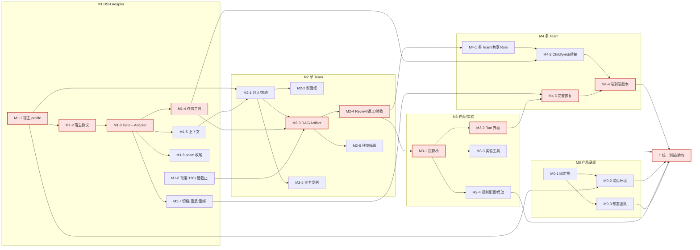

# DS Bot + Squad M0→M4 开发规划（2026-10-18）

> **2026-10-19：D1–D12 已拍板**，见 [§决策记录](#决策记录2026-10-19)。下面的工作包和工作量已按决定调整；§3 保留原始选项表备查。
>
> **前提**：用户决定先把 M0 到 M4 全部开发完成（直到 M4 多 Team 协同能完整跑通），再统一做测试和验收。中间阶段只要求编译和单测通过；每个里程碑结束时用现有 mock 自动化（`drive-p1.mjs` 等）回归一次（D10）。不再做 P0/P1 那样的新负例测试轮。
>
> **依据**：
> - [`dsh_squad_case/MIGRATION_PLAN.md`](../dsh_squad_case/MIGRATION_PLAN.md)（M0–M4、TR-01～TR-18）
> - [`dsh_squad_case/ACCEPTANCE.md`](../dsh_squad_case/ACCEPTANCE.md)（28 项）
> - [P0/P1 报告](dsh-squad-p0-probe-report-2026-10-18.md)，尤其是 §9
> - `feat/dsh-p1-seam` 上的现有代码：`dsh_squad/`（ds-bot seam 补丁、Squad Gate）、`probes/`、`pi_squad/controller/`

## 决策记录（2026-10-19）

用户于 2026-10-19 对 §3 的 D1–D12 拍板如下。与原建议不同的地方加粗。

| ID | 决定 | 对工作包的影响 |
|---|---|---|
| D1 | **今后以 DS Bot 为主要验证对象，不再关注 pi_squad。Go Controller 及相关 Go 代码全部迁移到 `dsh_squad/` 下，不与 pi_squad 共用；pi_squad 不再维护。**（原建议 A 共用，改为 B 复制后独立演进） | M1-1 改为「迁移到 `dsh_squad/controller`、换 module 路径、去掉 Pi 宿主 profile、只保留 DSH profile」；不再要求 Pi 路径能编译；后续所有 Controller 包都在新位置 |
| D2 | 补丁只做 seam（归属 + 拦截），界面做成独立的 DSH 客户端插件。**暂不向上游提 PR**，先完成我们自己的验证。不维护 fork | M1-8 去掉「起草上游 PR」；M3-2 以客户端插件交付 |
| D3 | 新定义协议版本 `squad/3` | M1-2 按 `squad/3` 设计，新头 `X-Squad-*`，不兼容 `pi-squad/2` 数据 |
| D4 | **不做一个宿主多用户。部署模型：一个项目目录 = 一个 DS Bot（DSH 宿主）+ 一个对应的独立 Controller；以后每个人自己部署。** 要做「按项目目录一键启动 DS Bot + Controller 配对」，不做多租户鉴权 | M0-2 从「每位试用者开通/回收」改为「按项目目录一键启动配对」；X-3 只做单部署内的凭据分层，不做多租户 |
| D5 | **要最终版界面**：任务依赖图、Artifact 预览、Review/恢复卡、三类按钮、实验报告页；直接做在 DS Bot 现有界面里，不另做独立网站 | M3-2 从「A + 部分 B」扩为完整 B，工作量 8 → 12 |
| D6 | **产品目标是非开发用户能完整使用 Squad**：能设定规则（Team/Workflow/Role）、启动小队、在界面看到进度、支持多个 Team。非开发用户试用放到 Squad 功能完成之后 | 新增 M3-4「规则配置与小队启动界面」；试用移到 T 阶段末尾 |
| D7 | 开发阶段全部用 mock；全部开发完成后才做真实测试，**只接 DeepSeek API（`https://api.deepseek.com`）的 `deepseek-flash`（thinking enabled，`reasoning_effort` high）**。不再要求两家 Provider，相关验收按单模型调整并注明。key 届时由用户提供 | M0-3 预置团队只用一个模型；ACCEPTANCE DSH-M0-02 改为单模型路由与冻结检查；M3-3 对照实验固定单模型 |
| D8 | Artifact 存储取最简单可行方案：Controller 的 hash 目录。用户关注产品能力，不关注过程产出物本身，不多投入 | M2-3 用 `<runtime>/artifacts/sha256/<hash>`，不做 DSH attachments 集成 |
| D9 | 固定 DSH 0.2.1-rc.2、DS Bot `e13bc34`；以后定期评估上游最新版本，没有破坏性更新就不升级 | 风险 4 降级；不安排「T 前升级一次」 |
| D10 | 里程碑结束用 mock 自动化测试回归；真实模型测试在全部开发完成后进行 | 新增 X-4「里程碑 mock 回归」：每个里程碑末跑 `drive-p1.mjs` 等现有驱动，并保持它们随代码演进可运行 |
| D11 | 沿用数学知识点课件案例 | M2-5 不变 |
| D12 | 正式 Run 开始时 Memory 快照只读；对照实验每组用全新 Team | M2-1 做快照只读视图；M3-3 每组新建 Team |

**执行顺序**（用户要求）：从 `feat/dsh-dev-plan` 切 `feat/dsh-m1`，按 M1 → M0 → M2 → M3 → M4 → T 推进。M0 不再等试用者（D6），且 M0-2 的配对启动依赖 M1-1 迁移后的 Controller，所以排在 M1 之后。每个里程碑结束：编译 + 单测 + mock 回归，在 `docs/log.md` 记录。

## 进度

| 里程碑 | 状态 | 说明 |
|---|---|---|
| M1 | 开发完成（2026-10-19） | M1-1～M1-7 落地；M1-8 完成持久化与上报，Q35「外层插件绕过」负例未做。编译 + 单测通过（`check.sh`）；mock 回归 `drive-p1` 14/14、`drive-m1` 7/7。切段重绑只有实现没有端到端负例（Q39）。不是验收结论，ACCEPTANCE 各项仍为 NOT_RUN |
| M0 | 开发完成（2026-10-19） | M0-1～M0-3 落地：`dsh_squad/deploy/dsh-squad up/down/status/provision`，预置四个 Bot（`deepseek-flash`、effort high）、群「小队群」、团队记忆。里程碑回归 `drive-m0` 12/12、`drive-p1` 14/14、`drive-m1` 7/7。非开发用户试用按 D6 放在 T 阶段 |
| M2 | 开发完成（2026-10-19） | M2-1～M2-5 落地：`bind-team` 把 Team 绑到一个群（缺的 Bot 自动创建），Leader 用 `squad_decide`、审核用 `squad_review`，退回 → 返工 → 复审 → Leader 完成；Artifact 存 Controller hash 目录（D8）；群里说的话在 Run 中变成 Run Guidance；数学课件案例 `dsh_squad/cases/math`。M2-6 只做到服务端隔离（CSP sandbox、禁网络），界面 iframe 在 M3（Q42）。Memory 快照只读（D12）未做，放到 M3-3 对照实验一起做。回归：`drive-m2` 12/12、`drive-m0` 12/12、`drive-p1` 14/14、`drive-m1` 7/7、`check.sh` 通过 |
| M3、M4、T | 未开始 | — |

## 0. 起点：已经有什么

| 组件 | 现状 | 对后续的意义 |
|---|---|---|
| Go Controller `pi_squad/controller/` | 约 1.1 万行非测试 Go：task 410、scheduler 4812、agent 921、httpapi 1105、project 1831 等。Stage04 的 Run/Task/Attempt、DAG、Review、Acceptance、FIFO、WaitGraph、continuation、recovery 都已实现，并在 Pi 上 89/89 通过 | M2 和 M4 的业务逻辑**大部分可以复用**，主要工作是换宿主、接适配器 |
| Controller 与 Pi 的耦合 | 集中在 `project/doctor.go`（`HostProfile = "pi-coding-agent/1.1.0"`）和 `project/probe.go`；协议头是 `X-Pi-Squad-*` | 需要抽象宿主 profile |
| 业务 120 秒硬截止 | `scheduler/dispatch.go:136` 仍有 `DeadlineAt = now + 120s`，到期后让祖先任务失败 | 2026-10-04 已决定取消，**必须改掉** |
| ds-bot seam 补丁 | 已提供：创建时归属、固定拦截点、resume/resend 开关、`dsBotSeam` 服务 | M1 适配器的地基 |
| Squad Gate | 已有准入判定、组合结束判定、冻结模型、tool guard、step 审计。`/api/squad-gate` 只是测试替身 | 要改造成真正的 DSH Adapter |
| 测试设施 | `probes/` 下有 bench、mock 驱动、探针；`drive-p1.mjs` 有 14 个受控负例 | 统一测试阶段直接复用 |

## 1. 工作包

工作量按「1 名开发者加 AI 辅助」的**人日**估算，误差约 ±40%，最终以实际为准。每个包的最低验证固定为：`go build ./... && go test ./...`、`dsh_squad/gate` 单测、`prepare-ds-bot.sh --test`；有界面的包再加一次手动打开页面。

### X：贯穿全程

| ID | 目标 | 产物 | 仓库 / 模块 | 依赖 | 人日 |
|---|---|---|---|---|---|
| X-1 | 一条命令完成构建和最低验证 | `dsh_squad/scripts/check.sh`：Go 构建与单测、Gate 单测、补丁应用并跑 ds-bot 单测；可选接入 GitHub Actions | 本仓库 | — | 1 |
| X-2 | 使用说明 | `dsh_squad/USAGE.md`：配置、启动、会话内命令和工具。AGENTS.md 要求的「能用的功能同步写进使用说明」照此执行 | 本仓库 | 随各包更新 | 0.5/里程碑 |
| X-3 | 凭据与权限分层 | 单部署内（D4）Controller operator 凭据、runtime 凭据、浏览器 cookie 三者隔离的约定和实现；不做多租户 | Controller、Adapter | M1-3 | 1 |
| X-4 | 里程碑 mock 回归（D10） | 每个里程碑末跑一次 `drive-p1.mjs` 等现有 mock 驱动；Gate 演进为 Adapter 后保留测试替身入口或同步改驱动，保证驱动一直能跑 | `probes/` | 各里程碑 | 0.5/里程碑 |

### M0：完整的 DS Bot 产品基线

| ID | 目标 | 产物 | 仓库 / 模块 | 依赖 | 人日 |
|---|---|---|---|---|---|
| M0-1 | 固定可分发的栈 | 启动器：固定 DSH 0.2.1-rc.2 加打补丁的 ds-bot（D9）。Free 模式下 Adapter 不接管任何会话。提供脚本，独立 `DSH_HOME` | `dsh_squad/deploy/` | — | 2 |
| M0-2 | 按项目目录一键启动配对（D4） | `dsh-squad up <项目目录>`：在该目录下的 `.dsh-squad/` 放 `DSH_HOME`、Controller 数据库、日志和 pid（Controller 的锁、discovery、operator 凭据按其契约留在 `.agents/dshsquad/.runtime/`），启动一个 DS Bot 宿主 + 一个 Controller，互相发现；`down`/`status`。不做多租户鉴权 | `dsh_squad/deploy/` | M0-1、M1-1 | 2 |
| M0-3 | 预置团队 | 自动创建 Chief、Researcher、Builder、Reviewer 四个 Bot、一个群聊、初始 Memory。开发期用 mock；真实测试只用 DeepSeek `deepseek-flash`（thinking、effort high，D7） | `dsh_squad/deploy/provision.mjs`（经 `/api/bot`） | M0-1 | 1 |

M0 小计约 5 人日。

### M1：DSH Adapter（M2 的硬前置）

| ID | 目标 | 产物 | 仓库 / 模块 | 依赖 | 人日 |
|---|---|---|---|---|---|
| M1-1 | Controller 迁移到 DSH | 把 `pi_squad/controller` 复制到 `dsh_squad/controller`（新 module 路径，独立演进，D1）；去掉 Pi 宿主 profile 和 managed 安装检查，只保留 `dsh/0.2.1-rc.2+ds-bot/e13bc34` profile；doctor/probe 改为检查 DSH/ds-bot；独立 DB 和数据域 | `dsh_squad/controller` | — | 3 |
| M1-2 | 宿主协议 | `squad/3`（D3）。一个宿主进程内有多个 runtime：每个受控（Bot, 位置）各自注册、各自拿凭据，绑定 `binding_epoch`；导出 schema | `dsh_squad/controller` `httpapi/agent`、`dsh_squad/protocol/` | M1-1 | 3 |
| M1-3 | Gate 变成 Adapter | 用 Controller 客户端替换测试路由，负责：注册和心跳；拉取派发（SSE 或轮询）；签发准入（`attempt_id`、`segment_id`、`fence`、`epoch`）；上报 AttemptEvent（opened、tool、result_proposed、settled、interrupted、`outcome_unknown`）。被扣留的输入持久化后交给 Controller（Q36） | `dsh_squad/gate` → `dsh_squad/adapter` | M1-2 | 6 |
| M1-4 | Bot 的正式任务工具 | 在受控会话里注册：提交结果（结构化）、yield/child、clarify、读当前任务。把 `pi_squad/extension/task-tools.ts` 的语义移植到 `ctx.tools.register`；只在活动 attempt 内可用 | `dsh_squad/adapter` | M1-3 | 4 |
| M1-5 | 上下文组装 | 受控会话的 role、team、task 段落（移植 `context-assembly.ts`），用 Agent 作用域的 `systemPrompt.section`；记录上下文 hash | `dsh_squad/adapter` | M1-3 | 2 |
| M1-6 | 取消业务硬截止 | 删掉 `dispatch.go` 的 120 秒 `DeadlineAt` 及其让祖先失败的逻辑；必要子任务明确回传之后才允许完成；通信 lease 保留 | Controller `scheduler/` | — | 1.5 |
| M1-7 | 切段、重启与重新绑定 | part 切换上报为 `binding_epoch+1`；重启后读持久日志对账，结果进 `outcome_unknown`；接通 operator 的 reconcile/rebind 入口 | Adapter、Controller `scheduler/recovery` | M1-3 | 3 |
| M1-8 | seam 补丁收尾 | 扣留队列持久化，rewake 稳定（Q37），兜底路径补齐（Q35）。暂不提上游 PR（D2） | `dsh_squad/patches/ds-bot`、Adapter | M1-3 | 1.5 |

M1 小计约 24 人日。

### M2：单 Team 真实交付

| ID | 目标 | 产物 | 仓库 / 模块 | 依赖 | 人日 |
|---|---|---|---|---|---|
| M2-1 | 配置导入与 Run 冻结 | 读项目目录下的 Role、`team.json`、Workflow，生成 Role 到 Bot 的映射（缺的 Bot 自动创建）。Run 冻结模型、工具、上下文 hash；Memory 在 Run 开始时快照为只读视图（D12） | Controller `project/`、Adapter | M1-1、M1-5 | 4 |
| M2-2 | 群聊受控模式 | 群设置 Managed 开关（一个群对应一个 Team，一个 Team 同时只有一个 active Run）。群里的用户消息分成通知、Run Guidance、修改、澄清，交给 Controller | Adapter、seam（群消息入口） | M1-3、M2-1 | 4 |
| M2-3 | DAG 派发与 Artifact | 按依赖和容量派发到 Bot；不可变 Artifact（`artifact_id`、`content_hash`、`result_revision`），存在 Controller 的 hash 目录（D8） | Controller `scheduler/dispatch`、Adapter | M1-4、M2-1 | 4 |
| M2-4 | Review、返工、验收 | 独立 Reviewer 审查精确的结果版本；被拒时新增 rework 和 re-review 节点；Final Gate。主要复用 `scheduler/{reviews,acceptance,invalidation}` | Controller、Adapter | M2-3 | 3 |
| M2-5 | 业务案例 | 数学知识点：研究、课件实现、格式检查、教学审核、返工复审、交付。Team、Workflow、Role 模板（D11） | `dsh_squad/cases/` | M2-1 | 2 |
| M2-6 | 课件预览隔离 | 独立 origin 的 sandbox iframe，读不到 DS Bot 的 cookie 和控制接口 | DS Bot 客户端插件（D5） | M2-3 | 2 |

M2 小计约 19 人日。

### M3：界面与对照实验

| ID | 目标 | 产物 | 仓库 / 模块 | 依赖 | 人日 |
|---|---|---|---|---|---|
| M3-1 | 投影桥 | Controller 的 Snapshot 和 Events 经宿主通道送到浏览器；SSE 断档就重新取快照；前端不自建状态机 | Adapter（宿主通道）、Controller `projection/` | M2-4 | 3 |
| M3-2 | Run 界面（最终版，D5） | 在 DS Bot 现有界面里：启动 Run，任务依赖图（DAG）、等待、Artifact 预览、Review 和恢复卡片、实验报告页。「回答问题」「批准工具」「验收成果」分成三类按钮，都绑定 `expected_revision` | DS Bot 客户端插件 `dsh_squad/client`（D2） | M3-1 | 12 |
| M3-3 | 对照实验工具 | S、A、B、C（D 在 M4 之后）五组固定配置，单模型 `deepseek-flash`（D7），每组新建 Team（D12）；指标采集（含辅助调用和被取消调用的成本，M8/M11）；报告生成，供 M3-2 的报告页展示 | `dsh_squad/experiments/`、复用 `probes/tokens.mjs` | M2-4、M3-1 | 4 |
| M3-4 | 规则配置与小队启动（D6） | 非开发用户在 DS Bot 界面里新建/编辑 Team、Workflow、Role（写回项目目录配置，经 Controller 校验）；Team 列表支持多个 Team；从群里启动小队并跳到进度页 | 客户端插件、Controller `project/` 写接口 | M2-1、M3-1 | 5 |

M3 小计约 26 人日。

### M4：高级协同治理

| ID | 目标 | 产物 | 仓库 / 模块 | 依赖 | 人日 |
|---|---|---|---|---|---|
| M4-1 | 多 Team 与共享 Role | 一个 Bot 在多个群（多个 Team）各有一个受控会话，即同一 Bot 多个绑定；接通 Primary/Secondary、跨 Team 原子准入、FIFO（Go 已有） | Adapter、Controller `scheduler/{runs,waitgraph}` | M2-4 | 4 |
| M4-2 | Child、yield 与同一 Attempt 续接 | capacity=1 时父任务 yield 暂停，子任务回传后用新 segment 在原 attempt 内续接；必要子任务未完成时拒绝父任务完成 | Adapter（工具与注入）、Controller `continuation` | M1-4、M4-1 | 4 |
| M4-3 | 完整恢复 | cancel、reconcile、retry、rebind、resume 的 operator 流程；宿主或 Controller 崩溃；迟到结果审计；界面卡片 | Controller、Adapter、界面 | M1-7、M3-2 | 4 |
| M4-4 | 端到端剧本 | Team A、B 共享 Reviewer，Team C 独立；可脚本化地完整跑一遍，作为「M4 能跑通」的标志 | `dsh_squad/cases/m4/` | M4-1～M4-3 | 2 |

M4 小计约 14 人日。

### T：统一测试与验收

见 §4。约 10 人日；非开发用户试用（D6，放在 Squad 功能完成之后）的日历时间另计。

**合计**：约 105 人日（X 约 7、M0 5、M1 24、M2 19、M3 26、M4 14、T 10）。按 §2 的并行方式，关键路径约 54 人日，加余量约 65 人日。（原 93 人日；增加来自 D5 最终版界面 +4、D6 规则配置界面 +5、D10 里程碑回归 +2.5，减少来自 D4、D2、D7。）

## 2. 关键路径与执行顺序

**关键路径**（红色）：M1-1 → M1-2 → M1-3 → M1-4 → M2-3 → M2-4 → M3-1 → M3-2 → M4-3 → M4-4 → T，约 3+3+6+4+4+3+3+12+4+2+10 ≈ **54 人日**。加联调余量约 65 人日。

**执行顺序**（2026-10-19 拍板后，同一行可并行）：

1. **M1**：M1-1、M1-6、X-1 → M1-2 → M1-3（最大的包）→ M1-4、M1-5、M1-7、M1-8。末尾 X-4 回归。
2. **M0**：M0-1 → M0-2（配对启动，依赖 M1-1）、M0-3。末尾 X-4 回归。
3. **M2**：M2-1、M2-5 → M2-3 → M2-4；并行 M2-2、M2-6。末尾 X-4 回归。
4. **M3**：M3-1 → M3-2；并行 M3-3、M3-4。末尾 X-4 回归。
5. **M4**：M4-1 → M4-2；M4-3（依赖 M3-2 的卡片）；M4-4。末尾 X-4 回归。
6. **T**：统一测试（真实模型只用 `deepseek-flash`，key 届时由用户提供），修复，再回归一轮；最后安排非开发用户试用。

## 3. 决策点原始选项（已于 2026-10-19 拍板，见决策记录）

| ID | 问题 | 选项 | 建议 | 影响 |
|---|---|---|---|---|
| **D1** | Go Controller 放在哪 | A. 留在 `pi_squad/controller`，加宿主 profile，Pi 和 DSH 共用一份；B. 复制到 `dsh_squad/controller` 后分开演进；C. 抽成独立的宿主无关模块，两边引用 | **A**：Stage04 的逻辑只有一份，不会分叉。代价是 Pi 那条路径也要能编译通过，PASS 记录仍然不继承 | M1-1 及后续所有 Controller 包 |
| **D2** | 是否继续用补丁改 ds-bot | A. 继续用补丁（seam 和界面都放补丁里）；B. 补丁只放 seam，界面做成独立的 DSH 客户端插件；C. 维护 ds-bot fork 分支；D. 先向上游提 seam PR | **B 加 D**：补丁已能覆盖 seam；M3 的界面估计数千行，放进补丁会难以维护。不建议 fork，上游迭代太快 | M1-8、M3-2；补丁规模 |
| **D3** | 宿主协议版本 | A. 新定义 `squad/3`（宿主中立）；B. 在 `pi-squad/2` 上加 host 字段 | **A**：多 runtime 同进程、epoch、扣留输入这些概念 v2 都没有；新旧数据不混跑 | M1-2、Adapter 客户端 |
| **D4** | 多租户与身份 | A. 每位试用者一个独立 DSH 宿主和数据域（计划里的默认做法）；B. 一个宿主多用户；C. 先只在开发者本机 | **A**：DS Bot 的单个 `DSH_HOME` 不是多租户设计。需要你定部署位置（本机、内网机器还是云主机）、访问方式（token 链接、反代 + TLS）、试用人数 | M0-2、X-3 |
| **D5** | 界面范围 | A. 最小：DS Bot 侧边栏里的 Run 卡片和任务列表；B. 完整：DAG 图、Artifact 预览、Review 和恢复卡片、实验报告页；C. 独立的 Web 控制台，不进 DS Bot | **先 A 再补成 B 的必需部分**（三类按钮、Artifact 预览、Review 卡），DAG 图放最后；C 偏离「同一界面」的目标 | M3-2 工作量（8 人日按 A 加部分 B 估算） |
| **D6** | M0 非开发用户试用怎么安排 | A. 现在就在 Free 模式下试用，和开发并行，只收集反馈，不等 Squad 功能；B. 按你的决定放到最后统一做 | **A**：M0 不依赖 M1–M4，早收集反馈风险最低；正式的 M0-01～04 判定仍在 T 阶段做 | M0-2、M0-3 的时间点；需要你找试用者 |
| **D7** | 真实模型 key 何时需要 | A. M0 预置团队时就要（至少两个 Provider）；B. 开发期全部用 mock，T 阶段才要；C. 每个里程碑结束时各用少量 key 冒烟一次 | **B 为主**：开发期 mock 就够。**T 阶段必须有**：至少两个 Provider（DeepSeek 加另一家），供 M0-02、M1-09、M3 对照实验使用；如果 D6 选 A，M0 试用时也要。还需要你给出预算上限 | T、M0 试用、M3-3 |
| **D8** | Artifact 存在哪 | A. DSH attachments（`saveFile`）；B. Controller 自己的 blob 目录，按内容 hash 寻址；C. 工作区里的文件加 hash | **B**：不可变、可审计，不依赖 DSH 内部存储 | M2-3、M2-6 |
| **D9** | 开发期间是否升级 DSH / DS Bot | A. 钉死 0.2.1-rc.2 和 `e13bc34`，到 T 前再升级一次；B. 跟着上游升级 | **A**：P1 的 rewake 依赖 rc.2 的行为（Q37） | 全部 |
| **D10** | 中间阶段是否保留现成的自动化回归 | A. 完全按你的决定，只编译加单测；B. 另外把已有的 `drive-p1.mjs`（mock，约 13 分钟，不花 token）当冒烟回归，每个里程碑结束时跑一次 | **建议 B**：不新写负例，只复用已有的。P1 的第一轮就发现过三个「编译和单测都发现不了」的问题。选 A 的话，这类问题会集中在 T 阶段暴露 | 中间阶段的质量信号 |
| **D11** | M2/M3 的业务案例 | 确认用「数学知识点课件」（研究 → 实现 → 检查 → 教学审核 → 返工 → 交付），还是换别的 | 维持计划里的案例 | M2-5、M3-3 |
| **D12** | 实验的 Memory 冻结方式 | A. Run 开始时快照个人和团队 Memory，只读视图；B. 每组实验独立的新团队 | **A 用于正式 Run，B 用于对照实验** | M2-1、M3-3 |

## 4. 统一测试阶段与 ACCEPTANCE 28 项的对应

**测试方式**：
- **自动化**：复用 `probes/`（bench、mock、探针、Gate 决策日志），把 `drive-p1.mjs` 扩展成 `drive-accept.mjs`，按用例 ID 输出 `case_id`、`run_id`、`attempt_id` 等 ACCEPTANCE 要求的证据字段。
- **真实模型**：需要 D7 的 key。
- **手动**：界面、非开发用户试用。

状态只用 `NOT_RUN`、`PASS`、`FAIL`、`PARTIAL`、`BLOCKED`；P0/P1 的结果**不能直接继承**，要在最终代码上重跑。

| ACCEPTANCE | 内容 | 实现包 | 测试方式 | 可复用 |
|---|---|---|---|---|
| DSH-M0-01 | 只用 Web，四 Bot 群聊 | M0-1、M0-3 | 非开发用户试用 + 手动检查 | — |
| DSH-M0-02 | 模型路由正确（D7 改为单模型：`deepseek-flash`、thinking、effort high） | M0-3 | 真实模型 + 探针 `agent/request` | P0 real 的路由记录方法 |
| DSH-M0-03 | `@Bot`、普通 Handoff、记忆 | M0 | mock 自动化 + 试用 | P0 S1、S2 |
| DSH-M0-04 | 刷新、重启、跨试用者隔离 | M0-2 | 自动化（重启）+ 两个试用环境交叉检查 | P0 S4 |
| DSH-M1-01 | 正式 Task 全链路证据 | M1-3、M1-4 | mock 自动化 | P1 P1-admitted |
| DSH-M1-02 | 重复 `request_id`、重连、重复 Event | M1-2、M1-3 | 自动化：注入重复请求 | Controller 已有的 CAS/幂等测试 |
| DSH-M1-03 | `@Bot`、message_bot、post_to_group 绕行 | seam、M1-3 | mock 自动化 | P1 N1、N2、N3 |
| DSH-M1-04 | 定时、原生 Prompt、恢复重投 | seam、M1-7 | mock 自动化 | P1 N4、N11 |
| DSH-M1-05 | 入队前后断网、宿主重启 | M1-3、M1-7 | 自动化（断开 Controller 连接、重启） | P1 N11 |
| DSH-M1-06 | result_proposed 但工具未收尾 | judge、M1-4 | mock 自动化 + 单测 | Gate judge 单测 |
| DSH-M1-07 | 切段、旧 Epoch、迟到事件 | M1-7 | mock 自动化 | P1 N8（fence）、N10 |
| DSH-M1-08 | 嵌套 run_code、shell、未授权 MCP/路径 | M1-4、tool guard | mock + 真实模型（PTC） | P0 real S8；需补「外层插件绕过」负例（Q35） |
| DSH-M1-09 | 模型不可用或 Effort 改变 | Gate 冻结路由 | mock 自动化 | P1 N12 |
| DSH-M1-10 | 取消后恢复 | M1-7、M4-3 | mock 自动化 | P1 N7、N9 |
| DSH-M2-01 | 并行与依赖 | M2-3 | mock 自动化（业务案例 DAG） | Controller 调度测试 |
| DSH-M2-02 | Builder 的 Artifact 交给 Reviewer | M2-3、M2-4 | mock 自动化 + 真实模型 | — |
| DSH-M2-03 | 拒绝 → 返工 → 复审 | M2-4 | mock 自动化 | Stage04 用例思路 |
| DSH-M2-04 | 用旧卡片通过新 Artifact | M2-4、M3-2 | 自动化（API）+ 手动（界面） | — |
| DSH-M2-05 | 模型自称「已完成」但缺 settled | judge、M2-4 | mock 自动化 | P1 judge 单测 |
| DSH-M2-06 | 必要 child 未结束时父任务完成 | M1-6、M4-2 | mock 自动化 | — |
| DSH-M2-07 | HTML/JS 课件预览隔离 | M2-6 | 手动 + 浏览器自动化（读 cookie 应失败） | — |
| DSH-M3-01 | SSE 断线、旧 Snapshot | M3-1 | 自动化（断流）+ 手动 | — |
| DSH-M3-02 | 三类按钮与 `expected_revision` | M3-2 | 手动 + API 自动化 | — |
| DSH-M3-03 | Free 与 Managed 同任务对照 | M3-3 | 真实模型实验 | P0 real 的 token 统计方法 |
| DSH-M3-04 | 辅助调用计入成本 | M3-3 | 真实模型 + ledger | `probes/tokens.mjs` |
| DSH-M4-01 | A/B 共享 Reviewer、C 独立 | M4-1、M4-4 | mock 自动化（端到端剧本） | — |
| DSH-M4-02 | capacity=1 的 Child/yield | M4-2 | mock 自动化 | — |
| DSH-M4-03 | 崩溃、迟到结果、换人 | M4-3 | 自动化（杀进程）+ 手动对账 | P1 N11 |

**T 阶段的估算与顺序**：
1. 扩展自动化驱动，补齐证据字段：2 人日。
2. mock 全量（约 20 项）：2 人日。
3. 真实模型（M0-02、M1-08、M2-02、M3-03、M3-04），只用 DeepSeek `deepseek-flash`：2 人日，外加 token 预算。
4. 界面手动（M2-04、M2-07、M3-01、M3-02）：1 人日。
5. 非开发用户试用（M0-01～04 及 D6 的完整 Squad 使用）：1 人日准备 + 试用日历时间，在 Squad 功能全部完成之后。
6. 修复和回归：2 人日起。

合计约 **10 人日**；修复所需时间取决于中间阶段积累了多少问题（见 D10）。

## 5. 主要风险（规划层面）

1. **推迟测试，问题会集中爆发**：P1 第一轮的三个问题都属于「能编译、单测也过，但真实宿主上不对」。T 阶段的修复时间可能明显超过估算，D10 的建议就是为了降低这个风险。
2. **Adapter（M1-3）是最大的不确定点**：Controller 原本按「一个 Pi 进程一个 runtime」设计，现在要支持同一进程里多个 runtime 和 epoch，可能牵出 Controller 的修改。
3. **界面规模**：D5 选最终版、D6 加规则配置，M3 是第二大里程碑（约 26 人日），且全部在 DS Bot 客户端插件里实现，受其扩展点限制。
4. **上游变化**：D9 钉死版本，只在定期评估发现无破坏性更新时才考虑升级；`rewake` 等依赖 rc.2 行为的点（Q37）随升级重测。
5. **试用的组织工作**（D4、D6）不在开发者控制范围内，可能拖长日历时间。
