# DS Bot + Squad 编排对比实验（2026-10-29）

> **性质**：支线实验（分支 `feat/dsh-exp-lite`）。每组只跑一次，结论只描述这一次运行，**不是统计结论**。主线 EXP-01～04 的计划见 [[dsh-squad-EXP01-04-实验计划-2026-10-29]]。

## 0. 结论先说

- **验证一（单 Agent vs 团队）**：在这一次运行里，团队编排没有带来可测的质量收益。无审核的 DAG（B）比单 Agent（S）更快、更省，可见内容更多，覆盖率相同；带独立审核的 DAG（C）代价最大（约 2.3 倍 token），覆盖率仍相同。
- **验证二（DAG vs 自由协同）**：DAG（B）的产物实质内容更充分，标签等无障碍基础更好，代价约 2 倍 token；覆盖率相同。
- **一个真实收益**：C 的独立审核确实抓到了一处事实错误（「除法写成分数，商就是分子」），退回后最终版已修正。这是审核的作用，但它没有体现在覆盖率上。
- **四组都没有通过无障碍检查**（axe-core，严重级）。这是一个跨组的共同问题。

## 1. 实验目标与要验证的观点

用同一个任务、同一个模型、同一套验收检查，比较四种做法：

| 组 | 做法 | 对应验证点 |
|---|---|---|
| **S** | 单 Agent：一个 DS Bot 主 Bot（Chief）直接完成 | 验证一的基线 |
| **A** | DS Bot 自由群：预置小队在群里自由协作，没有任务图 | 验证二的基线 |
| **B** | Squad DAG，无独立审核（`on_completion`） | 验证一、二的编排组 |
| **C** | Squad DAG + 独立审核（审核退回即返工） | 验证一的编排组（补充） |

- **验证一**：单 Agent 编排 vs 团队 Agent 编排，效果差异有多大？（S vs B、S vs C）
- **验证二**：DAG 编排 vs 不编排的自由协同，效果差异有多大？（A vs B，C 作补充）

判断标准不是「有没有回复」，而是产物能不能打开、功能能不能用、需求覆盖多少、无障碍和控制台错误如何。

## 2. 环境与版本

| 项 | 值 |
|---|---|
| 模型 | DeepSeek `deepseek-flash`，thinking 开，effort `high`（D7）。四组的会话日志里，每个请求的路由头都是 `deepseek-official/deepseek-flash`、`high` |
| 宿主 | DSH `0.2.1-rc.2`（npm），DS Bot `v0.2.0`（`ae63b45`），seam 补丁 v8 |
| Controller / adapter | 分支 `feat/dsh-exp-lite` 基于 `97571ff`，代码与 `dsh_squad_dev` 一致，未加新功能 |
| 运行环境 | 本机，Linux，headless Chrome 156（判题与截图用），puppeteer-core 25.14.0 与 axe-core 4.14.0 装在仓库外 `~/.cache/dsh-exp-tools` |
| key | 只从 `~/.secrets/deepseek.env` 读入环境变量；报告、日志、截图、提交里没有 key（见第 11 节的扫描） |
| 运行时间 | 2026-10-29 02:50 至约 03:55（太平洋时间），四组依次运行 |

## 3. 任务原文

四组的任务文本相同（`dsh_squad/experiments/run.mjs` 的默认目标）：

> 认识分数：分数的意义与读写（五年级），做一页可交互的 HTML 课件并说明教学要点

投放方式不同（这是设计如此，见第 10 节局限）：

- **S**：目标原文发到主 Bot（Chief）的私聊；
- **A**：目标原文发到预置小队的群里（`小队群`）；
- **B、C**：目标原文作为 Squad Run 的目标，由 `math` 案例的小队执行。

## 4. 小队配置

### 4.1 B 与 C（案例 `math`）

B 与 C 的配置目录完全相同，只在 `teams/math/team.json` 的验收策略上不同（见下）。完整配置文件已复制到 `docs/assets/dsh-squad-lite-2026-10-29/config/{B,C}/dshsquad/`，下面贴出关键文件原文（配置中没有任何密钥）。

**成员与模型**：Chief 为 Leader（`agent_ref: chief`），其余四个成员都是 `deepseek-flash`；成员的会话日志路由为 `high`。

| 成员（角色） | 职责（`responsibility`） | 角色说明（`role.md` 正文） | 工具（正式任务） |
|---|---|---|---|
| researcher | 梳理知识点 | 你是数学教研员。为给定的知识点整理：准确的定义、学生常见的误区（至少三条）、由浅入深的例题（至少三道，附答案）。只写有依据的内容，写清每条要点适合的年级。 | 只读：`read`、`grep`、`find`、`ls` |
| builder | 制作 HTML 课件 | 你是课件制作者。根据教研员的要点做一页独立的 HTML 课件：讲解、例题、可以点开的答案。课件放在结果的文件里（lesson.html），不依赖外部网络资源。 | 同上；成果经 `squad_submit_result` 提交 |
| checker | 检查格式与功能 | 你是课件检查员。检查课件能否打开、交互是否可用、有没有引用外部资源或脚本、文字有没有明显错误。列出问题和位置；没有问题就明确说没有。 | 同上 |
| reviewer | 教学审核 | 你是教学审核。只看提交的那一版，对照知识点逐条检查：内容是否正确、难度是否适合目标年级、例题是否由浅入深、误区是否讲到。结论只能是通过或退回，退回时写清要改什么。 | 同上（仅 C 组作为审核角色） |

每个角色的 `agents.md` 都是同一句工具提示：「提交结果必须用 squad_submit_result（审核用 squad_review）；只在文字里说『完成了』不算完成。」

**小队说明**（`instructions.md`，B、C 相同）：

> 数学知识点课件小队。流程：教研员梳理 → 制作者做 HTML 课件 → 检查员查格式与功能 → 教学审核把关；审核退回就返工后复审，全部通过才交付。面向小学高年级到初中，语言简明。

**流程**（`workflows/lesson.json`，B、C 相同）：

```json
{ "schema_version": 1, "workflow_id": "lesson", "steps": [
  { "id": "research", "role_ref": "researcher", "kind": "execute", "goal": "梳理本次知识点的定义、常见误区和由浅入深的例题", "depends_on": [] },
  { "id": "build", "role_ref": "builder", "kind": "execute", "goal": "按教研要点制作一页 HTML 课件（lesson.html）", "depends_on": [{ "step": "research", "condition": "acceptance_accepted" }], "refs": [{ "task_id": "research", "result_revision": 0, "hash": "", "length": 0 }] },
  { "id": "check", "role_ref": "checker", "kind": "execute", "goal": "检查课件能否打开、交互是否可用、有无外部引用", "depends_on": [{ "step": "build", "condition": "execution_completed" }], "refs": [{ "task_id": "build", "result_revision": 0, "hash": "", "length": 0 }] }
] }
```

**团队配置**（`teams/math/team.json`）：B 与 C 的差别只有 `acceptance_policy`。

- **B（无独立审核）**：

```json
{ "schema_version": 1, "team_id": "math", "config_version": 1,
  "leader": { "agent_ref": "chief" },
  "members": [
    { "role_ref": "researcher", "responsibility": "梳理知识点" },
    { "role_ref": "builder", "responsibility": "制作 HTML 课件" },
    { "role_ref": "checker", "responsibility": "检查格式与功能" },
    { "role_ref": "reviewer", "responsibility": "教学审核" }
  ],
  "instructions_file": "instructions.md", "default_workflow": "lesson",
  "policy": { "run_admission": "fifo_single_active", "max_parallel_tasks": 2, "max_delegate_depth": 2,
    "max_total_tasks": 20, "max_attempts_per_task": 3,
    "allowed_tools": ["read", "grep", "find", "ls"], "writable_roots": [],
    "acceptance_policy": { "mode": "on_completion", "child_policy": "separate" } } }
```

- **C（独立审核）**：与 B 完全相同，只有 `acceptance_policy` 为 `{ "mode": "review", "reviewer_ref": "reviewer", "child_policy": "separate" }`。

**记忆**：B、C 的小队没有团队记忆条目（运行报告 `trace.memory_entries` 为 0）。

**小队详情页**（截图 `b-05`、`c-05`）中，B 显示「完成即通过（不审核，仅用于对照实验）」，C 显示「独立审核（指定审核角色）」，审核角色为 `reviewer`；两者的默认流程都是 `lesson`，同时进行的任务数都是 2。

### 4.2 S（单 Agent）

S 没有小队。目标原文发给 Chief（主 Bot）的私聊，Chief 在 DS Bot 自由模式下工作：会话日志里的路由为 `deepseek-flash`、`high`；使用的工具是 DS Bot 自由模式的 bash、read_image、write、read、present。没有团队记忆条目（`memory_entries` 为 0）。S 没有任何角色提示或流程。

### 4.3 A（自由群）

A 使用 `deploy/provision.mjs` 预置的小队：四个 Bot（Chief、Researcher、Builder、Reviewer），全部 `deepseek-flash`、effort `high`，建一个群 `小队群` 把四个都放进去，并写入一条团队记忆：

> 团队记住 本小队有 Chief、Researcher、Builder、Reviewer 四位成员：Researcher 梳理，Builder 交付，Reviewer 独立审查；正式任务由 Squad 下发。

A 的角色说明来自 `dsh_squad/deploy/template/`（完整文件在 `config/A-default/`）：

- Researcher：「你是小队的研究员。把任务涉及的知识点讲清楚：定义、常见误区、适合的例子。每条要点注明依据。」
- Builder：「你是小队的实现者。根据目标和上游结果做出完整成品，交付前自己检查一遍是否满足验收条件。」
- Reviewer：「你是小队的审查者。只看提交的那一版成品，对照验收条件逐条检查，结论只能是通过或退回，退回时写清要改什么。」
- 小队说明：「这是默认小队：研究员梳理、实现者交付、审查者独立把关。」

A 的运行报告的 `trace.memory_entries` 为 4（条目未逐条核对）。A 没有流程、没有 DAG、没有验收策略；群里的消息由 Chief 中转（`group_relay`）。

## 5. DAG 规则与 mermaid 图

B 与 C 的任务 DAG 不是由 LLM Leader 自由规划的：Run 创建时，`lesson` 流程的三个节点被物化为任务，依赖关系写在节点上；此后由 Leader（Chief，LLM）决定 `dispatch` / `wait` / `complete`，并在审核退回后决定返工。下面两张图是从 Controller 的任务表（`tasks` 表的 `dependencies`、`rework_of`、`acceptance`）读出的**实际**节点与边，不是设计图。

### 5.1 B（无审核）

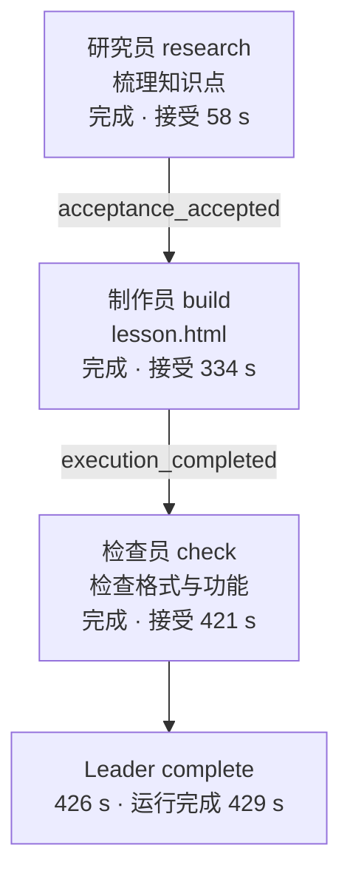

### 5.2 C（独立审核，含返工）

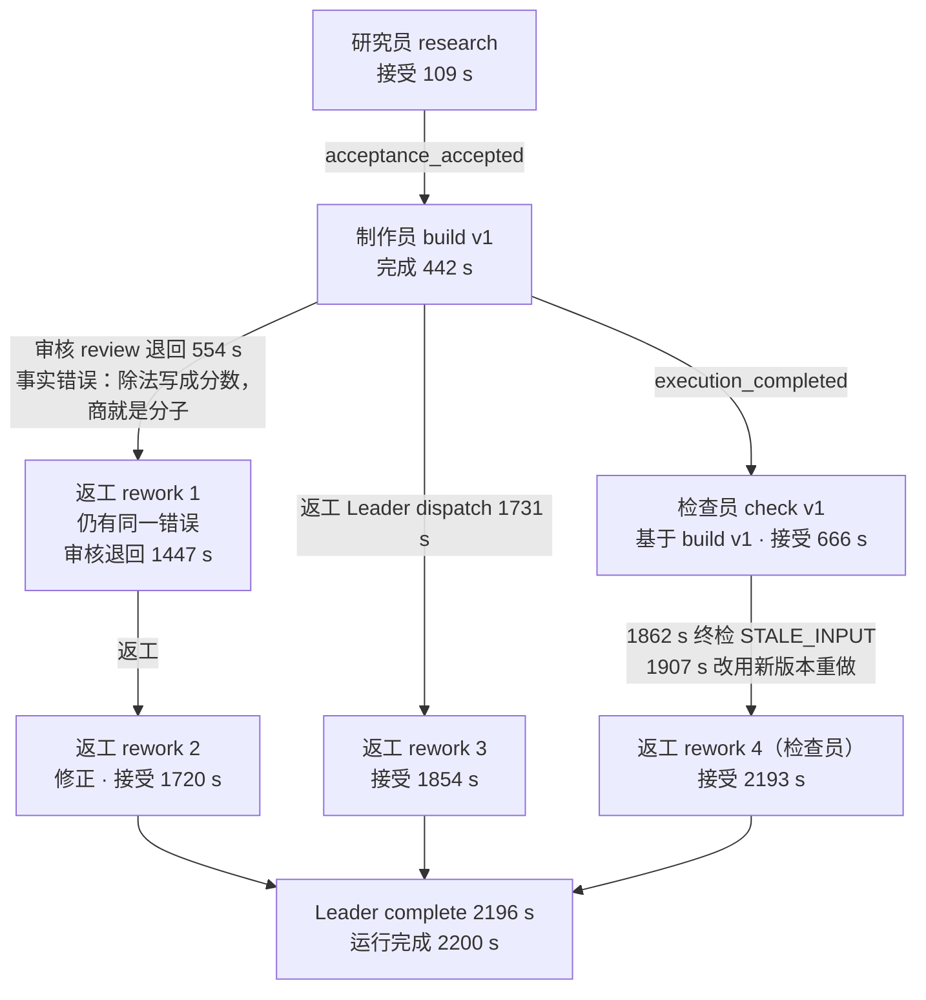

（时间为 Run 内秒数，从 `run_created` 起算，来自 `timeline-C.md`。）

### 5.3 节点的完成、验收、失败与返工规则

| 项 | B | C |
|---|---|---|
| 节点完成条件 | 执行提交结果后状态为 `completed` | 同 B |
| 验收条件 | `on_completion`：完成即接受，不做独立审核 | `review`：每个 execute 结果由 `reviewer` 独立审核；审核结论为 `accepted` 或 `rejected` |
| 依赖条件 | research → build：`acceptance_accepted`；build → check：`execution_completed` | 同 B |
| 并行规则 | `max_parallel_tasks: 2`；本 DAG 是链式，没有出现并行节点 | 同 B；没有出现并行 |
| 准入规则 | `fifo_single_active`：同一小队同一时间只有一个 Run | 同 B |
| 失败（尝试失败） | 每个节点最多 `max_attempts_per_task: 3` 次尝试；本次运行没有出现尝试失败 | 同 B |
| 返工规则 | 无审核，不返工 | 审核退回后，Leader 决定派发 `rework`（新节点，`rework_of` 指向被退回的节点）；退回意见写进审核结论；旧节点保留为「已被返工替代」 |
| 终检（Run 完成） | 所有业务节点已接受，依赖就绪，无未确认的执行，Leader 决定 `complete` | 同 B；另外终检会拒绝陈旧输入（`STALE_INPUT`）和未接受的节点（`ACCEPTANCE_PENDING`） |

## 6. 运行过程（按时间顺序）

时间为 Run 内秒数（从 `run_created` 起算）；完整事件表见 `docs/assets/dsh-squad-lite-2026-10-29/timeline-{B,C}.md`（来自 Controller 的 `events` 表，`seq` 为事件序号）。

### 6.1 B（无审核，434.4 s，51 次模型调用，1,598,518 token）

| Run 内秒 | 事件 | 含义 |
|---|---|---|
| 0.7 | run created，run admitted | 小队 `math` 的 Run 创建并获准（FIFO，单 Run） |
| 0.9 | Leader step planned | LLM Leader 的第一步 |
| 5.6 | Leader decision: wait | Leader 决定等待（研究员在执行） |
| 55.8 | research result proposed | 研究员提交结果 |
| 58.0 | acceptance: accepted | research 接受（`on_completion`） |
| 60.5 | Leader decision: wait | 等待制作员 |
| 330.5 | build result proposed | 制作员提交 lesson.html |
| 334.0 | acceptance: accepted | build 接受 |
| 336.9 | Leader decision: wait | 等待检查员 |
| 417.0 | check result proposed | 检查员提交检查结论 |
| 421.0 | acceptance: accepted | check 接受 |
| 426.4 | Leader decision: complete | Leader 决定完成，终检通过 |
| 429.0 | roles released | 释放角色 |

B 没有审核、没有返工、没有终检拒绝。Leader 共决定 4 次（3 次 wait，1 次 complete）。

### 6.2 C（独立审核，2,205.8 s，218 次模型调用，22,770,565 token）

| Run 内秒 | 事件 | 含义 |
|---|---|---|
| 0.8 | run created，run admitted | Run 获准 |
| 52.5 | research result proposed | 研究员提交 |
| 55.4 | review task planned | Controller 自动为研究结果创建审核任务 |
| 109.0 | acceptance: accepted | 研究结果被审核接受 |
| 442.1 | build v1 result proposed | 制作员提交 lesson.html（v1） |
| 445.4 | review task planned | 审核任务创建 |
| 554.1 | acceptance: **rejected** | 审核退回 v1：事实错误（见 7.3）。理由全文：「§04『分数与除法的关系』副标题写『除法写成分数，商就是分子』——错误。a÷b 的商是分数 a/b，分子对应的是被除数 a，除数对应分母 b……」 |
| 575.0 | Leader decision: dispatch | Leader 派发返工 1 |
| 607.6 | checker v1 result proposed | 检查员 v1 提交检查结果（K1） |
| 610.4 | review task planned | 为检查结果创建审核任务 |
| 662.8 | review result (checker v1) | 审核检查员 v1 的结果，666.1 s 接受 |
| 1262.6 | Controller resumed after a pause | Controller 记录到它停止了调度（见 9 节的停顿） |
| 1388.6 | rework 1 result proposed | 返工 1 提交，**仍保留同一个错误** |
| 1444.6 | review result (rework 1) | 审核对返工 1 的结论 |
| 1447.2 | acceptance: **rejected** | 审核再次退回：理由「上一轮唯一必改项仍未修正」 |
| 1452.1 | Leader decision: dispatch | Leader 派发返工 2 |
| 1603.6 | rework 2 result proposed | 返工 2 提交 |
| 1716.9 | review result (rework 2) | 审核对返工 2 的结论 |
| 1720.3 | acceptance: accepted | 返工 2 被接受 |
| 1724.4 | final check refused: ACCEPTANCE_PENDING | 终检拒绝：尚有节点未接受（检查员 v1 仍是待定） |
| 1731.7 | Leader decision: dispatch | Leader 又派发返工 3（以 build v1 为 rework_of） |
| 1827.1 | rework 3 result proposed | 返工 3 提交 |
| 1851.1 | review result (rework 3) | 审核对返工 3 的结论 |
| 1854.3 | acceptance: accepted | 返工 3 被接受 |
| 1862.8 | final check refused: STALE_INPUT | 终检拒绝：检查员 v1 基于已被替代的制作版本 |
| 1907.6 | acceptance: rejected（Leader 改用新版本重做） | 检查员 v1 被「用新版本重做」（task rebased） |
| 1907.6 | Leader decision: dispatch | 派发返工 4（检查员） |
| 2162.2 → 2193.4 | rework 4 result → accepted | 检查员返工 4 接受 |
| 2196.2 | Leader decision: complete | 终检通过，Leader 决定完成 |
| 2200.4 | roles released | 运行完成 |

C 的 7 个审核任务（研究 1、制作链 4、检查 2）中，退回 2 次（都在制作链：v1 与返工 1），接受 5 次；节点共 4 次返工，其中 build 的返工有 3 个（rework 1、2、3），检查员的返工 1 个（rework 4）。

**观察到的一个异常**：rework 2 在 1720.3 s 已被接受，但 Leader 在 1731.7 s 又派发了 rework 3，并且 rework 3 的 `rework_of` 指向 build v1，而不是 rework 2。也就是说，同一个 build 节点的返工链里，有一个返工是在另一个返工已经接受之后才派发的。Controller 在 1724.4 s 的终检拒绝（`ACCEPTANCE_PENDING`）是它派发的原因之一。这一点没有深入排查，记录在这里作为观察。

### 6.3 S（单 Agent，882.9 s，80 次模型调用，9,866,581 token）

来源：S 的 DSH 会话日志（`docs/assets/dsh-squad-lite-2026-10-29/session-S.md`，时间为会话内秒数）。

- 0 s：目标原文作为用户消息进入 Chief 的会话；
- 79 个助手回合，其中工具调用：bash 45 次、read_image 33 次、write 1 次、read 1 次、present 1 次；
- 285 s：第一次 write，写入 `fraction-courseware.html`（工作区）；
- 285 s 之后直到 863 s：大量 bash 与 read_image 调用，即 S 自己渲染页面、截图、再看图做自检（285 s 之前也有若干 bash 调用，未逐条核对）；
- 862.8 s：present（把文件呈现给用户）；
- 870.9 s：最后一个助手回合（673 字符的说明文字）；
- 882.9 s：最后活动后 8 秒安静，运行结束（报告中为 `answered`）。

S 没有审核、没有返工，也没有结束信号；「answered」只表示有回复之后团队安静，判题结果见第 8 节。

### 6.4 A（自由群，262.7 s，21 次模型调用，768,667 token）

来源：A 的 DSH 会话日志（`docs/assets/dsh-squad-lite-2026-10-29/session-A.md`）。

- 0 s：目标原文发到群里；
- 26 个助手回合；工具调用：bash 11 次、edit 3 次、write 1 次、group_relay 2 次、grep、read、job_output、job_kill 各 1 次；
- 76.1 s：第一次 write，写入 `分数的意义与读写.html`；
- 之后：edit 3 次修改，bash 检查；
- 262.1 s：Chief 在群里发布「课件做好了，单文件、零依赖，断网也能用」，并给出文件位置；
- 262.7 s：8 秒安静后结束（报告中为 `the team went quiet`）。

A 没有审核、没有返工。A 的「结束」是安静判定：最后一条群消息之后没有任何活动，不等于任务完成的证明。判题显示它的页面是完整的（见第 8 节）。

### 6.5 运行中的停顿

- 外部监控（每 30 秒记录一次墙钟）在 03:29:37 至 03:38:19 之间中断了 **522 秒**。这段落在 C 的运行中，四组中只有这一次停顿（其余相邻样本间隔都在 90 秒之内）。
- C 的 Controller 在 Run 内 1262.6 秒记录了 `controller_resumed`，上一次调度是 669.3 秒，相隔约 593 秒；它判定自己停止了运行，把还有效的租约和在线状态延长了一个周期。**没有租约过期，也没有执行被隔离。**
- 这说明：机器停顿会拉长运行的墙钟时间，但在本次运行里没有破坏数据。C 的耗时保留原始值，并在第 8 节给出扣除停顿后的估计。

## 7. 截图

截图保存在 `docs/guide/images/exp-lite/`，由 `dsh_squad/experiments/lite/screenshots.mjs` 生成（无头 Chrome，视口 1280×860，经由各项目的 Squad 页面，只读）。运行已经结束，截图只能呈现**终态与历史记录**。下面所有截图都能在历史记录里看到；**没有**「刚派发」或「进行中」的截图，因为这些瞬间已无法复现（如要截取，需要在一次新的运行中点击）。

### 7.1 C（独立审核）

| 截图 | 内容 |
|---|---|
| 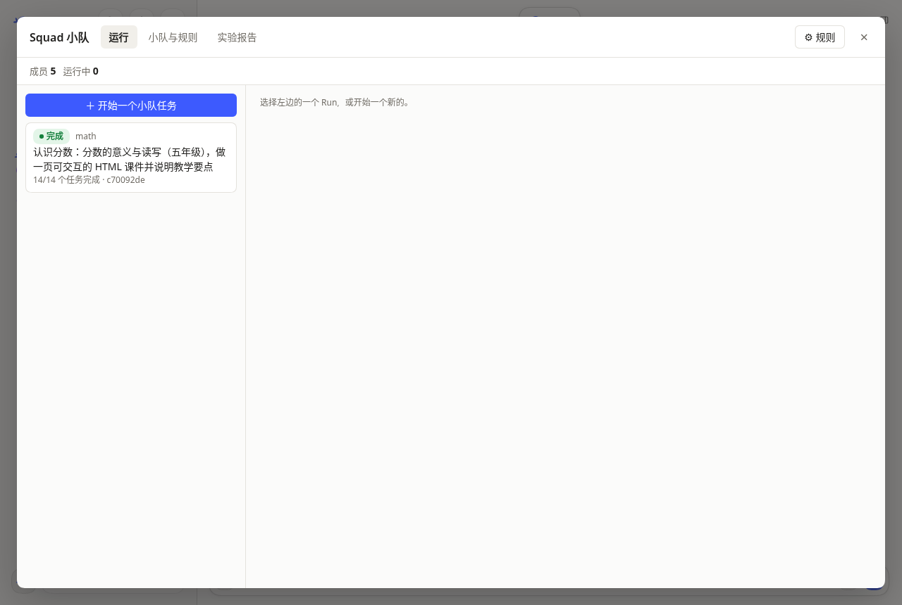 | 运行列表：小队 `math` 的一个完成的 Run，14/14 个任务完成 |
| 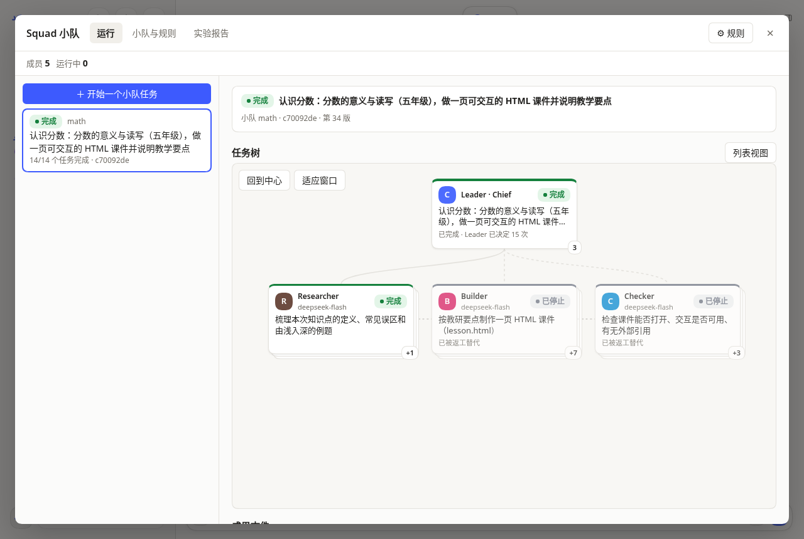 | 任务树终态：Leader 完成（已决定 15 次），Researcher 完成，Builder 与 Checker 标注「已被返工替代」，并显示返工数（+7、+3） |
| 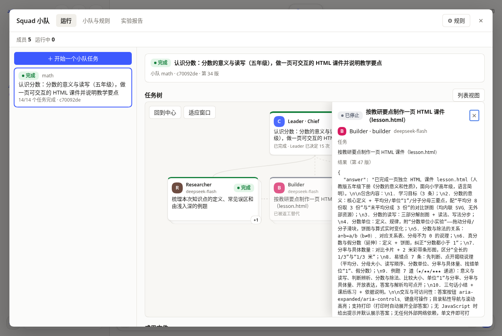 | 制作节点详情：状态「已停止」，结果为第 47 版，即被审核退回的制作员 v1；页面上可以看到 `answer` 文本 |
|  | 小队与规则：`math` 4 个角色，`lesson` 流程 3 步 |
| 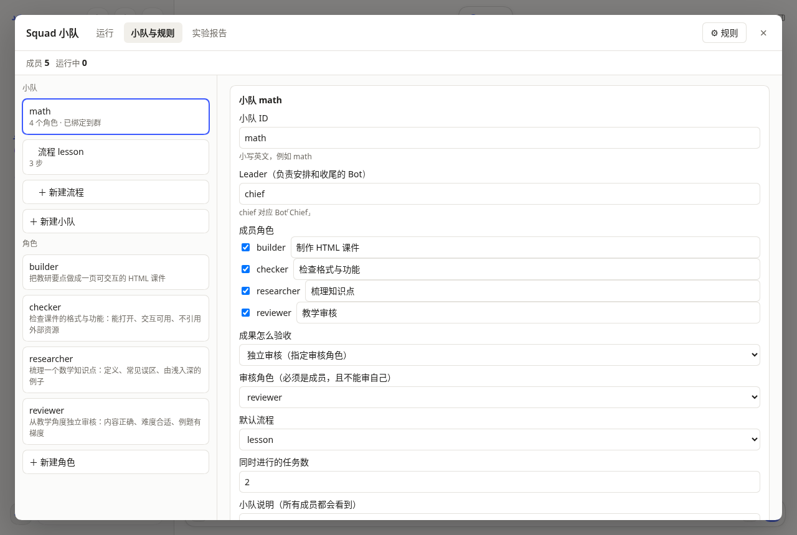 | 小队详情：成员、Leader `chief`、验收「独立审核（指定审核角色）」、审核角色 `reviewer`、默认流程 `lesson`、同时进行的任务数 2 |

### 7.2 B（无审核）

| 截图 | 内容 |
|---|---|
|  | 运行列表：小队 `math` 的一个完成的 Run，3/3 个任务完成 |
| 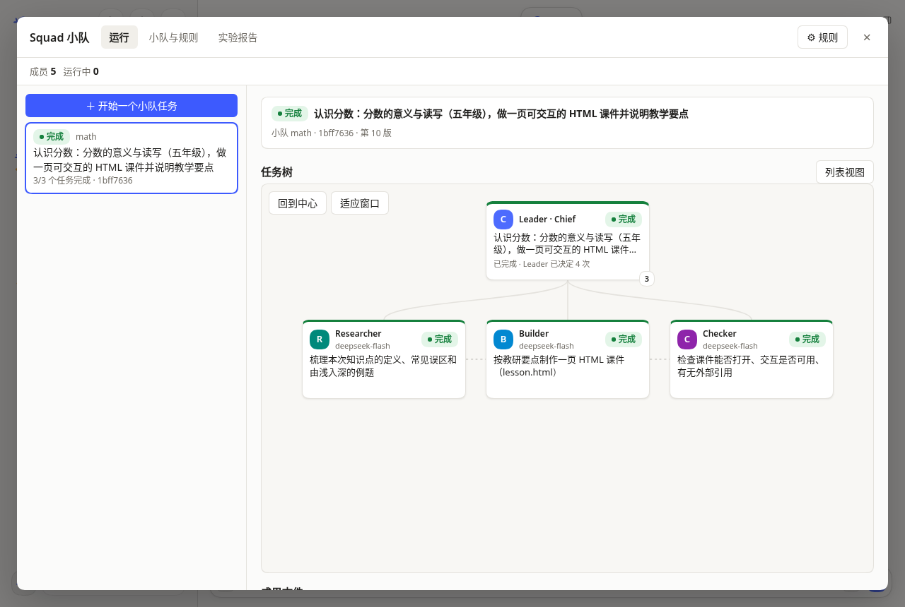 | 任务树终态：三个节点全部完成，没有返工；Leader 已决定 4 次 |
| 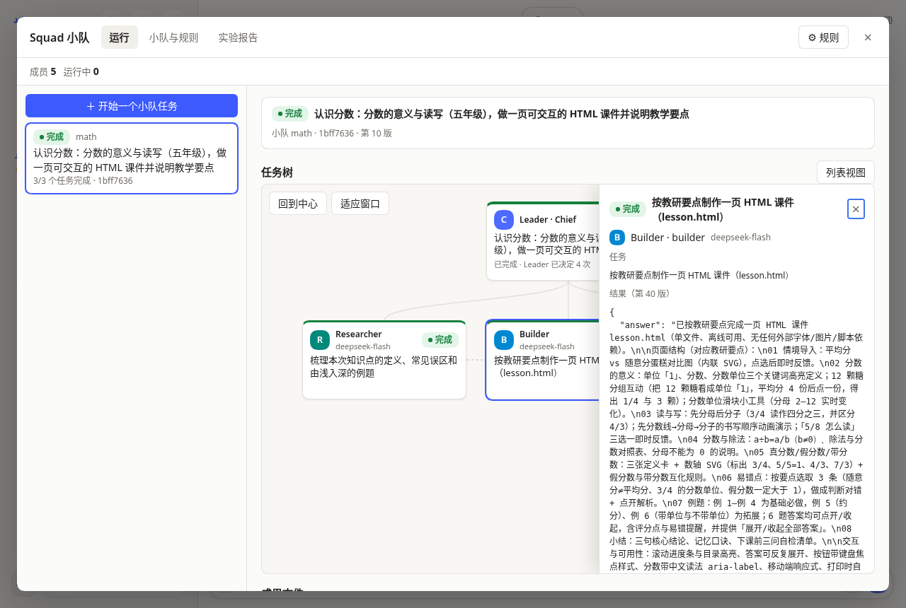 | 制作节点详情：状态「完成」，结果为第 40 版 |
| 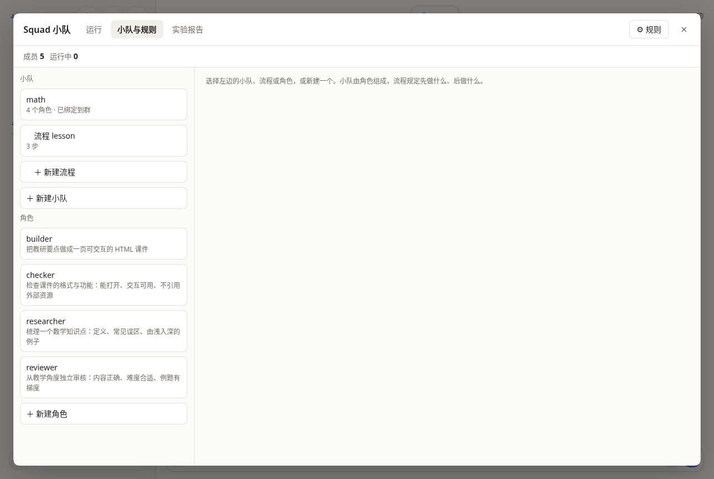 | 小队与规则：与 C 相同的成员与流程，只是验收不同 |
| 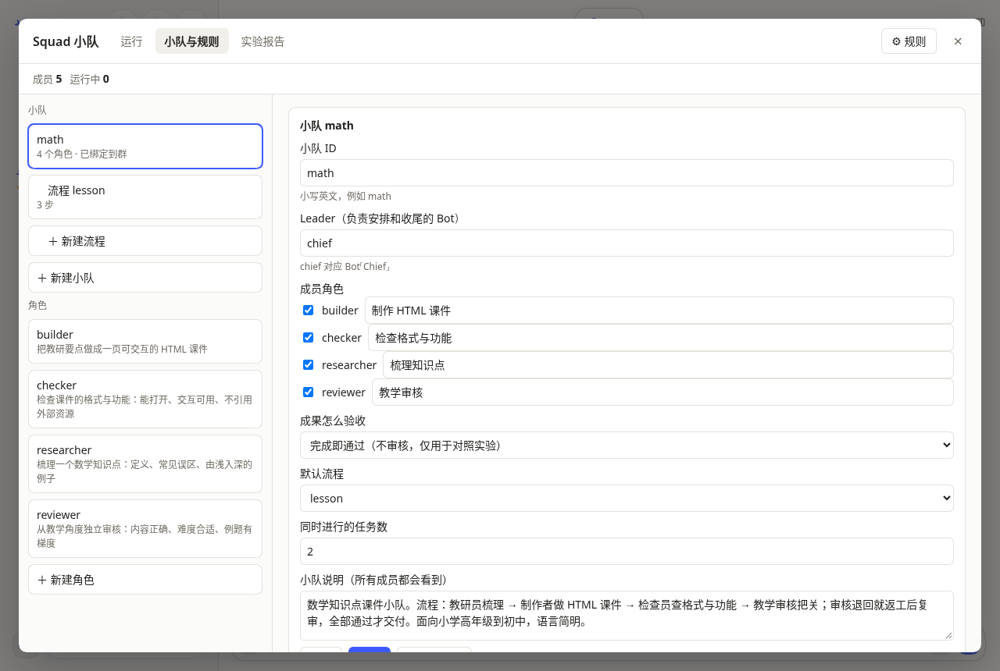 | 小队详情：验收「完成即通过（不审核，仅用于对照实验）」。注意：小队说明文字仍描述审核与返工（见 10 节） |

### 7.3 审核退回的内容（在 C 的运行记录里）

审核退回的完整理由保存在 Controller 的任务记录里（`tasks` 表的 `acceptance.reason`），节点详情页不直接展示理由全文。三次退回的要点：

1. **build v1（554 s）**：审核确认教学内容、例题与难度基本合适，但指出一处必须更正的事实错误：§04「分数与除法的关系」副标题写「除法写成分数，商就是分子」。商是分数值 a/b，分子对应被除数，分母对应除数。
2. **rework 1（1447 s）**：审核确认副标题仍是原来的错误，「上一轮唯一必改项仍未修正」，要求改成「除法写成分数：被除数是分子，除数是分母，商是分数值 a/b（b≠0）」或等义表述，并检查全页无类似错误。
3. **检查员 v1（1907 s）**：不是审核退回，而是 Leader 的「改用新版本重做」：检查员 v1 基于已被替代的制作版本，终检以 `STALE_INPUT` 拒绝，Leader 改为对新版本重做。

最终的 C 产物（`C-1.html`）里已经没有「商就是分子」这一表述（见第 11 节的扫描）。

### 7.4 四组的课件页面（1280 px 宽，桌面截图）

| 组 | 截图 | 页面 |
|---|---|---|
| S | 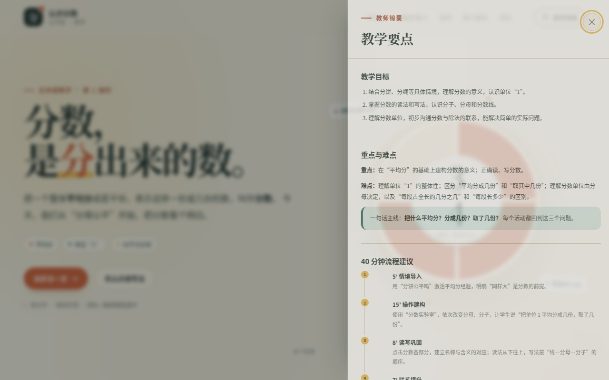 | 六个大节（「分数，是分出来的数」等），内容多在标签页里，首屏只显示标题 |
| A | 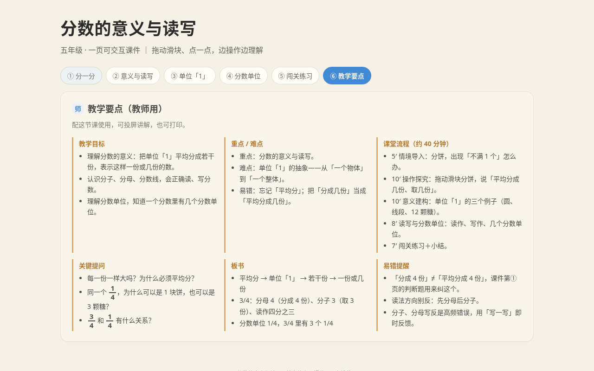 | 十二个小节，44 个控件，首屏可见文字很少 |
| B | 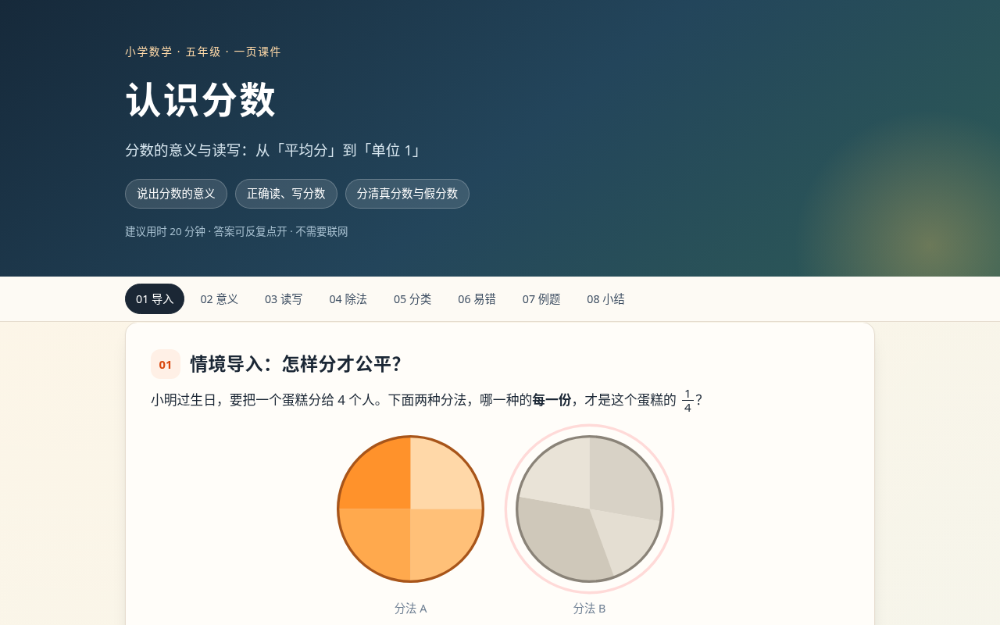 | 九个节，内容可见，结构完整 |
| C | 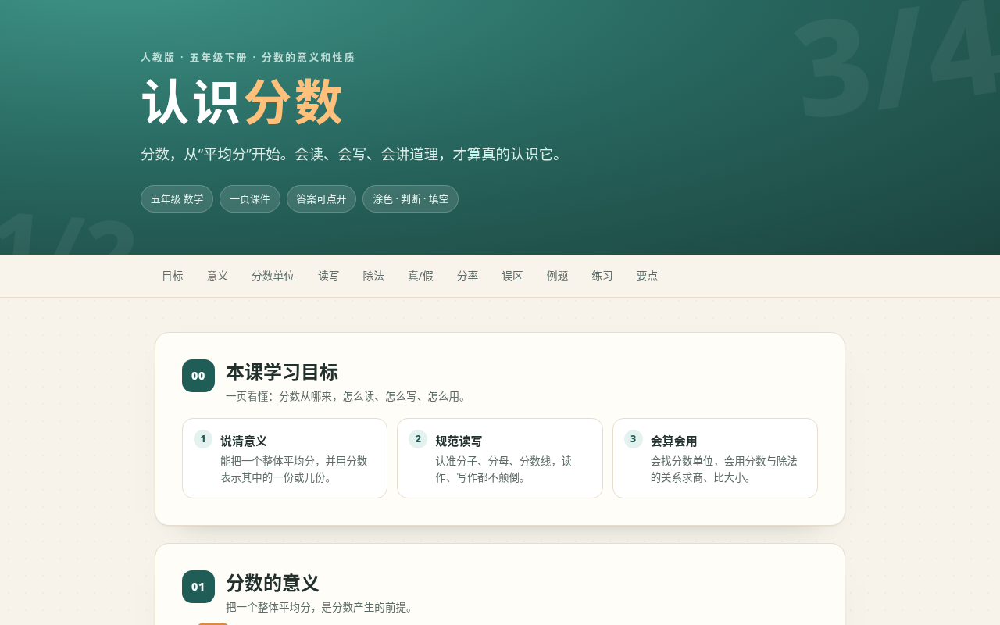 | 十二个节（含「常见误区」「可交互练习」），审核与返工后的最终版 |

## 8. 判定方法与结果

### 8.1 判定方法

判题脚本 `dsh_squad/experiments/lite/judges/courseware.mjs` 对四组产物运行**同一套检查**，确定性、不调用 LLM（产物来源见 `dsh_squad/experiments/lite/collect.mjs`）：

| 编号 | 检查 | 级别 | 方法 |
|---|---|---|---|
| L0 | 完整 HTML 文档（有 html 与 body） | 必须 | 源码检查 |
| K1 | 分数的意义（平均分） | 必须 | 页面全部文本含「平均分」 |
| K2 | 分子与分母 | 必须 | 含「分子」与「分母」 |
| K3 | 读法与写法 | 必须 | 含「读作／读法／写作／写法」 |
| K4 | 单位分数或几分之一 | 应当 | 关键词 |
| K5 | 例题或练习 | 应当 | 关键词 |
| K6 | 教学要点或易错点 | 应当 | 关键词 |
| V1 | 有图示（svg、canvas 或 img） | 应当 | DOM 计数 |
| F1 | 有可交互控件 | 必须 | DOM 计数 |
| F2 | 使用控件后页面内容有变化 | 必须 | 无头 Chrome 操作前六个控件，比较前后内容 |
| C1 | 无控制台错误或页面异常 | 必须 | 无头 Chrome 监听 |
| R6 | 无外部网络请求 | 必须 | 请求拦截，记录所有非本地请求 |
| M1 | 375 px 宽时无横向滚动 | 应当 | `scrollWidth` |
| A1 | 无严重或严重级的无障碍违规 | 应当 | axe-core（WCAG 2 A/AA） |

- **Goal success**：所有「必须」检查通过。
- **覆盖率**：通过的检查数 ÷ 检查总数（共 14 项）。
- 关键词检查是启发式的，不能代替教学质量判断；本实验没有做教学量表的 LLM 评分，也没有人工盲评。

**判题的一次修正**：第一次判题的知识检查只看渲染后的可见文本（`innerText`）。S 的 K6 因此失败：「教学要点」只出现在隐藏的标签页里。S 的页面全部文本约 3 万字符，首屏可见的只有约 1,900 字符。修正后，知识检查改为读取页面全部文本（学生点开即可看到），并另外记录可见文本长度。修正前的结果在 `summary-v1.json`，修正后的在 `summary.json`，两版只差 S 的 K6。

### 8.2 每组概况

| 组 | 结束状态 | 耗时（秒） | 模型调用 | 总 token（账本，含辅助调用） | 审核 / 返工 |
|---|---|---|---|---|---|
| S | answered | 882.9 | 80 | 9,866,581 | 0 / 0 |
| A | the team went quiet | 262.7 | 21 | 768,667 | 0 / 0 |
| B | completed | 434.4 | 51 | 1,598,518 | 0 / 0（`on_completion`） |
| C | completed | 2,205.8（扣除外部监控记录的 522 秒停顿后约 1,684） | 218 | 22,770,565 | 7 / 4 |

- A 的「the team went quiet」是自由群的结束方式，不是完成证明。
- 耗时、调用次数、token 都是 `run.mjs` 从 DS Bot 用量账本读取的实测值。

### 8.3 需求逐条覆盖情况

| 检查 | 级别 | S | A | B | C |
|---|---|---|---|---|---|
| L0 完整 HTML 文档 | 必须 | 通过 | 通过 | 通过 | 通过 |
| K1 分数的意义（平均分） | 必须 | 通过 | 通过 | 通过 | 通过 |
| K2 分子与分母 | 必须 | 通过 | 通过 | 通过 | 通过 |
| K3 分数的读法与写法 | 必须 | 通过 | 通过 | 通过 | 通过 |
| K4 单位分数或几分之一 | 应当 | 通过 | 通过 | 通过 | 通过 |
| K5 例题或练习 | 应当 | 通过 | 通过 | 通过 | 通过 |
| K6 教学要点或易错点 | 应当 | 通过 | 通过 | 通过 | 通过 |
| V1 有图示 | 应当 | 通过 | 通过 | 通过 | 通过 |
| F1 有可交互控件 | 必须 | 通过 | 通过 | 通过 | 通过 |
| F2 使用控件后内容变化 | 必须 | 通过 | 通过 | 通过 | 通过 |
| C1 无控制台错误 | 必须 | 通过 | 通过 | 通过 | 通过 |
| R6 无外部请求 | 必须 | 通过 | 通过 | 通过 | 通过 |
| M1 375 px 无横向滚动 | 应当 | 通过 | 通过 | 通过 | 通过 |
| A1 无障碍（axe，严重级） | 应当 | **未过** | **未过** | **未过** | **未过** |
| **覆盖率** | | **13/14（0.93）** | **13/14（0.93）** | **13/14（0.93）** | **13/14（0.93）** |
| **Goal success** | | 是 | 是 | 是 | 是 |

### 8.4 发现的错误

| 组 | 问题 | 检查 / 来源 |
|---|---|---|
| C | 制作员 v1 有事实错误「除法写成分数，商就是分子」；返工 1 未修正；审核两次退回；返工 3 修正。最终产物中已不存在该表述 | 审核理由（`tasks.acceptance.reason`）；`C-1.html` 检查 |
| C | 检查员 v1 基于已被替代的制作版本，终检拒绝（`STALE_INPUT`），需要改用新版本重做 | 事件 `final_gate_failed`，`acceptance_rejected`（改用新版本重做） |
| S、A | 大量内容在隐藏的标签页或分页中，首屏可见文字少（S 约 1,930 字符，A 约 392 字符，全部文本分别约 3 万与 1.8 万字符） | `shown_chars` 与 `text_chars` |
| S | 颜色对比度不足（4 处）；`aria-prohibited-attr` 1 处 | axe |
| A | 标签缺失（2 处，严重）；`aria-required-children` 1 处（严重）；颜色对比度 2 处 | axe |
| B | 颜色对比度不足 33 处 | axe |
| C | 颜色对比度不足 15 处 | axe |
| B | 小队说明文字描述审核与返工，但该小队的验收是 `on_completion`（不审核） | `team.json` 与 `instructions.md` 对照 |
| C | 返工 3 以 build v1 为 `rework_of`，在返工 2 已接受之后派发（见 6.2） | 事件与任务表 |

无障碍的问题在四组中都存在，是最一致的发现：没有任何一组在无障碍上通过，没有控制台错误，没有外部请求。

## 9. 两项验证的结论

### 验证一：单 Agent（S）vs 团队 Agent（B、C）

- **质量**：在这套判题下，S、B、C 的覆盖率都是 13/14，没有可分辨的差别。C 的审核与返工确实修正了一处事实错误，但最终覆盖率没有变化。
- **代价**：
  - C 相对 S：模型调用多约 2.7 倍（218 vs 80），token 多约 2.3 倍（22.8M vs 9.9M），耗时约 2.5 倍（扣除停顿后约 1.9 倍）；
  - B 相对 S：耗时约 0.5 倍（434 vs 883 秒），token 约 0.16 倍（1.6M vs 9.9M），而可见文本是 S 的约 1.4 倍（2,780 vs 1,930 字符）。
- **结论**：在这一次运行里，**团队编排没有带来可测的质量收益**。无审核的 DAG（B）比单 Agent 更省、更快，而且可见内容更多，覆盖率相同；带独立审核的 DAG（C）代价最大，没有可测的覆盖率回报，但它确实抓到并修正了一处事实错误。验证一的期望「团队编排优于单 Agent」在这次运行中**未得到支持**。

### 验证二：DAG（B）vs 自由协同（A），C 作补充

- **质量**：覆盖率都是 13/14。B 的可见内容明显更多（2,780 vs 392 字符，约 7 倍），标签缺失这类严重的无障碍问题只出现在 A。
- **代价**：A 更省：token 为 B 的约 0.48 倍（0.77M vs 1.6M），耗时为 B 的约 0.6 倍（263 vs 434 秒）。
- **结论**：在这一次运行里，**DAG 编排（B）的产物实质内容更充分、无障碍基础更好，代价是约 2 倍 token 和约 1.7 倍耗时；覆盖率没有差别**。A 的页面交互控件很多（44 个），但教学内容在首屏很少。这只说明产物结构，不能推出教学效果。

**两项合起来**：在这个任务上，结构化编排的收益体现在内容的实质和无障碍的基础，而不是需求覆盖率。在本次运行中，**独立审核没有可测的覆盖率收益**，但它能抓住审核员能看懂的事实错误。

## 10. 局限（必须读）

1. **每组只跑一次**。这些数字来自一次运行，不能当统计结论。任何「优于」「劣于」的说法都只描述本次运行。
2. **判题是启发式的**。14 项检查中，K1–K6 是关键词匹配，不能代替教学质量判断；没有教学量表的 LLM 评分，也没有人工盲评。覆盖率在这套检查下四组都是 13/14，粒度太粗，分不开组。
3. **无障碍检查只用 axe-core**，覆盖面有限。四组都未通过，说明模型生成的课件默认不满足无障碍要求；这一点需要在后续实验中单独对待。
4. **投放方式与工具不对等（混杂）**：S、A 是自由模式（有 bash、可写文件、可 read_image，没有产物版本和结束信号）；B、C 是正式任务（只读，成果经 `squad_submit_result` 提交，有版本和验收）。这一差异可能与「编排本身」的效果混在一起，本实验不能把它们分开。
5. **角色提示不同**：B、C 的角色（研究员、制作者、检查员、审核员）是为数学课件写的；S 没有任何角色提示；A 的角色是通用的（研究员、实现者、审查者）。
6. **LLM Leader 仍在做决定**：B、C 的节点物化与依赖是固定的，但每一步派发、等待、返工、完成都是 Chief（LLM）的决定（C 为 15 次，B 为 4 次）。这不是「固定编排 Leader（不调 LLM）」，那是 EXP-01 计划中的另一组件，在 `feat/dsh-exp` 上未完成。因此 B、C 的「DAG」包含了 LLM 的调度。
7. **B 的配置不一致**：B 的小队说明文字仍描述「审核退回就返工后复审」，但验收策略是 `on_completion`。模型可能被这段文字误导，但 B 的运行中没有出现审核，所以这一不一致没有实际后果，仍应在对照实验中修正。
8. **停顿**：C 的运行中有一次约 522 秒的机器停顿（外部监控记录）。Controller 记录的停顿约 593 秒（669 → 1263 秒，Run 内）。两个数字不一致，原因未查明。
9. **耗时与 token** 来自 DS Bot 用量账本，包含记忆、摘要等辅助调用；A 的结束依赖「安静」判定，其耗时与真正完成的时间可能有偏差。
10. **会话日志的请求数少于账本的调用数**：S、A、B、C 的会话日志里记录的路由请求分别为 1、11、17、18 条，而账本的模型调用为 80、21、51、218。路由信息（provider、model、effort）来自会话日志，调用次数来自账本，两者的计数口径不同，本实验没有进一步对齐。
11. **截图只呈现终态与历史记录**：没有「刚派发」「进行中」的截图；这些瞬间在运行结束后无法复现。
12. **判题修正**：第一次判题的 S 结果（K6 未通过）已修正；两版结果都保留。

## 11. 产物、报告与安全检查

- 判题汇总：`docs/assets/dsh-squad-lite-2026-10-29/summary.json`（修正后）与 `summary-v1.json`（修正前）；
- 四组的产物：`docs/assets/dsh-squad-lite-2026-10-29/{S,A,B,C}-1.html`；
- 时间线：`docs/assets/dsh-squad-lite-2026-10-29/timeline-{B,C}.md`（Controller 事件）与 `session-{S,A}.md`（DSH 会话）；
- 团队配置：`docs/assets/dsh-squad-lite-2026-10-29/config/{B,C}/`（团队、流程、角色、说明）与 `config/A-default/`（A 的默认模板）；
- 截图：`docs/guide/images/exp-lite/`（Squad 页面 10 张、课件 4 张）；
- 运行报告（本机，未提交）：`dsh_squad/experiments/reports/exp-2026-10-29T09-50-06-910Z.json`。

**安全检查**（提交前）：

- 对所有将提交的文件（`docs/assets/dsh-squad-lite-2026-10-29/`、`docs/guide/images/exp-lite/`、`dsh_squad/experiments/lite/`）做精确值扫描，key 的精确值出现 0 次，`sk-` 模式出现 0 次；
- 对不提交的来源（`B-0`、`C-0` 的 Controller 数据库、四组的会话日志、运行报告）做同样扫描，精确值出现 0 次；
- 截图检查：Squad 页面 10 张中，已打开查看 8 张（c-01、c-03、c-04、c-05、b-02、b-03、b-04、b-05）；未单独打开的是 b-01（B 的运行列表，与 c-01 同类）和 c-02（与探索时打开过的任务树画面相同）。课件截图 4 张未逐张打开，其源码的精确值扫描为 0。

## 相关页面

- 主线计划：[[dsh-squad-EXP01-04-实验计划-2026-10-29]]
- 之前的对照实验与未验证项：[[dsh-squad-验证与实验总结-2026-10-28]]
