# DS Bot + Squad 使用指南

这份指南写给**不写代码的使用者**：在浏览器里组建一个「小队」，让几个 AI 助手按你定的规则分工、互相审核、返工，最后交出成果。整篇按实际使用的顺序编排，从部署到看实验报告。

文中截图都来自 2026-10-20 的测试：带「真实模型」字样的是用 DeepSeek `deepseek-flash` 实际跑出来的，其余是用模拟模型跑同样的流程截的，界面完全一样。

> 想看所有配置字段、接口和命令的完整说明，查 [`dsh_squad/USAGE.md`](../../dsh_squad/USAGE.md)。

## 目录

1. [几个词先说清楚](#1-几个词先说清楚)
2. [部署和启动（一个项目目录一份）](#2-部署和启动一个项目目录一份)
3. [配置 DeepSeek](#3-配置-deepseek)
4. [打开 Squad 页面](#4-打开-squad-页面)
5. [建小队、角色、流程和规则](#5-建小队角色流程和规则)
6. [开始一个小队任务](#6-开始一个小队任务)
7. [看任务树和顶部汇总栏](#7-看任务树和顶部汇总栏)
8. [处理「需要你处理」和失败的步骤](#8-处理需要你处理和失败的步骤)
9. [返工和「基于旧版本」](#9-返工和基于旧版本)
10. [给 Leader 补充指导](#10-给-leader-补充指导)
11. [多个小队：总览和切换](#11-多个小队总览和切换)
12. [查看成果和实验报告](#12-查看成果和实验报告)
13. [键盘、深色模式、断线](#13-键盘深色模式断线)
14. [常见问题和故障排查](#14-常见问题和故障排查)

---

## 1. 几个词先说清楚

| 词 | 意思 |
|---|---|
| **Bot** | DS Bot 里的一个 AI 助手，有名字、头像、模型和记忆，可以私聊，也可以进群。 |
| **小队（Team）** | 一组 Bot 加一套规则：谁当 Leader、有哪些角色、成果怎么验收、默认按哪个流程做。 |
| **角色（Role）** | 小队里的一种分工，如「研究员」「制作者」「审核」。每个角色由一个 Bot 担任；同一个 Bot 可以在几个小队里担任同一个角色。 |
| **流程（Workflow）** | 先做什么、后做什么：每一步由哪个角色做、要等哪一步完成。也可以不用流程，让 Leader 自己安排。 |
| **Leader** | 小队的负责人 Bot：派任务、看进度、决定返工、最后宣布完成。 |
| **Run** | 小队接下的一次任务，比如「做一页认识分数的课件」。一个 Run 里有很多步骤（任务）。 |
| **审核 / 返工** | 成果交上来后由另一个 Bot 独立审核；不合格就退回，Leader 安排返工，再审，直到通过。 |

平时 Bot 是 **Free（自由）模式**：你在私聊、群聊里随便和它们聊。小队开始一个 Run 后，参与的 Bot 在小队的群里进入 **受控** 状态：只做 Controller 派给它的任务，只能用规则允许的工具，做完必须提交结果才算完成。这样每一步谁做的、交了什么、谁审的都有记录。

## 2. 部署和启动（一个项目目录一份）

**一个项目目录 = 一个 DS Bot + 一个 Controller**。每个人、每个项目各起一份，互不影响；不同项目的登录互相打不开（测试里验证过）。

第一次需要有人在机器上准备好本仓库（含 Node.js 和 Go）。之后启动只要一条命令：

```bash
# 启动（第一次会自动安装固定版本的 DSH、打好补丁的 DS Bot，并编译 Controller）
dsh_squad/deploy/dsh-squad up ~/my-project

# 预置一个四人小队：Chief、Researcher、Builder、Reviewer，一个群「小队群」和一条团队记忆
dsh_squad/deploy/dsh-squad provision ~/my-project

# 查看状态和浏览器登录链接
dsh_squad/deploy/dsh-squad status ~/my-project

# 停止
dsh_squad/deploy/dsh-squad down ~/my-project
```

- `up` 会打印一个带 `token=` 的登录链接，用浏览器打开就登录了。默认端口 3400，可以用 `--port 3500` 换。
- 所有数据都在项目目录的 `.dsh-squad/` 里：Bot、聊天记录、记忆、Controller 数据库、日志。停了再起，Bot、群、聊天历史和记忆都还在。
- `provision` 可以重复执行，已有的 Bot 和群不会重复创建。
- 只想看看界面、不想花模型费用时，可以加 `--mock` 用模拟模型（每次 `up` 都要带）。
- **只支持网页版**：Squad 跑在用 `dsh-squad up` 启动的 DS Bot 网页版里。DS Bot v0.2.0 起有独立的桌面版（Windows / macOS），它自带 DeepSeek Harness 和自己的数据目录，不加载 Squad，现阶段不支持。

## 3. 配置 DeepSeek

Squad 只用一个模型：DeepSeek `deepseek-flash`，开思考、推理强度 `high`。预置的 Bot 和小队自动新建的 Bot 都用它。key 有两种给法，任选其一。

**在页面里填（推荐给不写代码的使用者）**：不带 key 直接 `dsh-squad up`，打开页面后，Chief 会提示还没有模型，点「Enter a DeepSeek API key」，在弹出的框里粘贴 key，点「Save and continue」。key 由 DeepSeek Harness 存在这个项目自己的凭据库里（`.dsh-squad/home/.credentials.yaml`），输入框是遮住的，不会出现在页面、日志或 Squad 里。之后再执行一次 `dsh-squad provision`，预置的小队就用 `deepseek-flash`、high 开始工作。

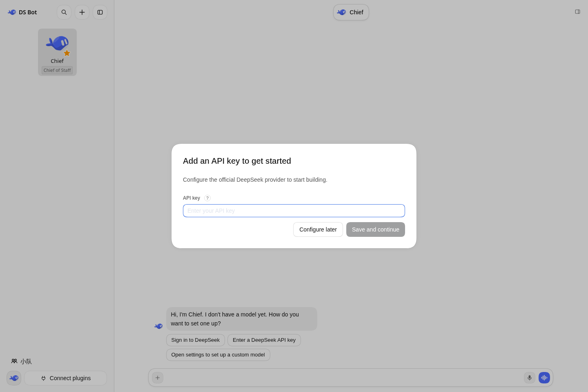

**从文件读（开发和测试用）**：把 key 放在 `~/.secrets/deepseek.env`（权限 600），由启动命令所在的 shell 读入环境变量：

```bash
# ~/.secrets/deepseek.env 的内容形如（这里只是变量名，值换成你自己的）
# DEEPSEEK_API_KEY=<你的 key>
# DEEPSEEK_BASE_URL=https://api.deepseek.com

( set -a; . ~/.secrets/deepseek.env; set +a; dsh_squad/deploy/dsh-squad up ~/my-project )
```

- 启动脚本只把环境变量里的 key 交给 DS Bot 进程，不写到磁盘、日志或页面上。两种都有时，用页面里填的那个。
- 受控任务里 Bot 的模型和思考档位会被「冻结」：小队有任务进行时改不了；万一绕过页面改了，正式任务也会在发请求前被拒，不会悄悄换模型继续做。

## 4. 打开 Squad 页面

登录 DS Bot 后，左下角有「小队」按钮，点开就是 Squad 页面。页面有三个标签：**运行**、**小队与规则**、**实验报告**；右上角「⚙ 规则」直接跳到当前小队的规则。

一个还没跑过任务的小队，打开时直接显示右侧的「开始一个小队任务」面板：

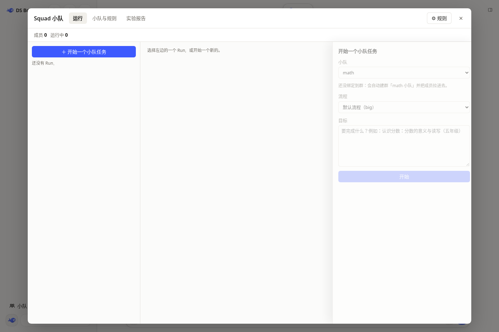

## 5. 建小队、角色、流程和规则

在「小队与规则」标签里，不用写任何文件就能建和改。左边列出小队（和它下面的流程）、角色；点一项在右边编辑。

**小队**：小队 ID、Leader 是哪个 Bot、有哪些成员角色（每个角色写一句职责）、**成果怎么验收**、审核角色、默认流程、同时进行的任务数、小队说明（所有成员都会看到）。

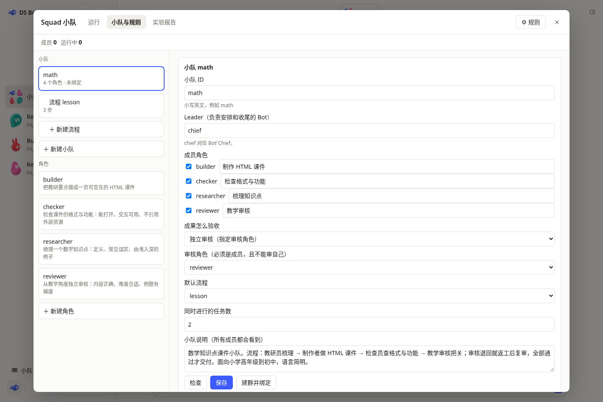

成果怎么验收有三种：

| 方式 | 适合 |
|---|---|
| 独立审核（指定审核角色） | 默认。每一步的成果由审核角色把关，不能自己审自己。 |
| 人工验收 | 你自己在 Squad 页面逐个点「通过 / 退回」。 |
| 完成即通过 | 不审核，只用于对照实验。 |

**角色**：名字、一句话说明、详细说明（这个角色怎么做事）和工作规则。

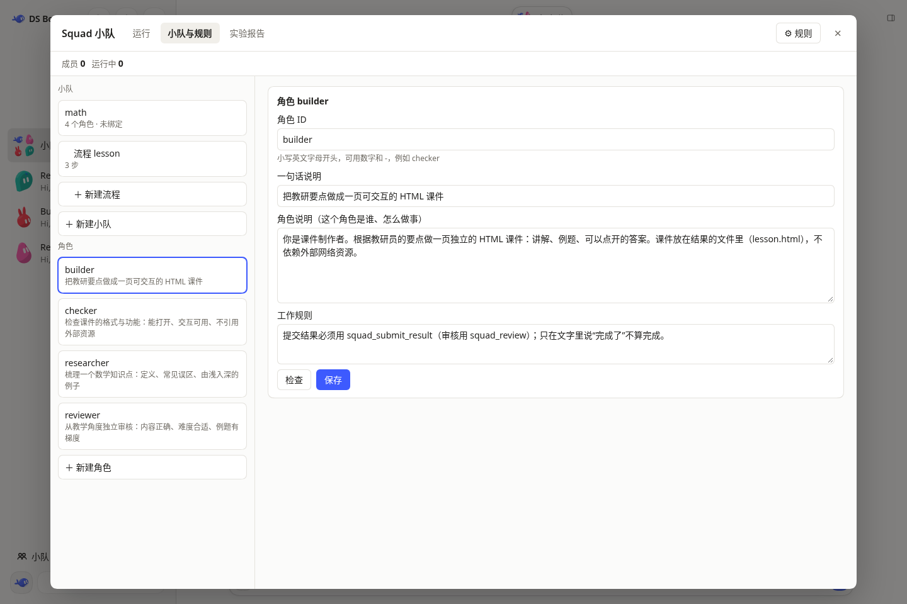

**流程**：一步一行，写清楚由哪个角色做、做什么、要等哪一步、等到什么程度（完成即可 / 验收通过才行）。

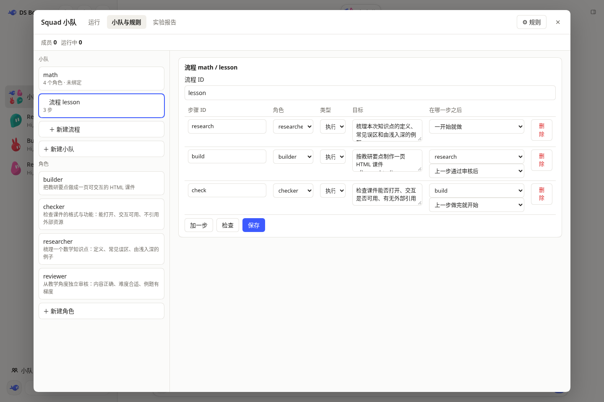

**新建小队**：点「＋ 新建小队」，填好后先点「检查」（只校验不保存），没问题再点「保存」。保存时 Controller 会校验整套配置，改了小队说明或流程会自动升版本。保存后点「建群并绑定」，或者直接开始任务时自动建群。

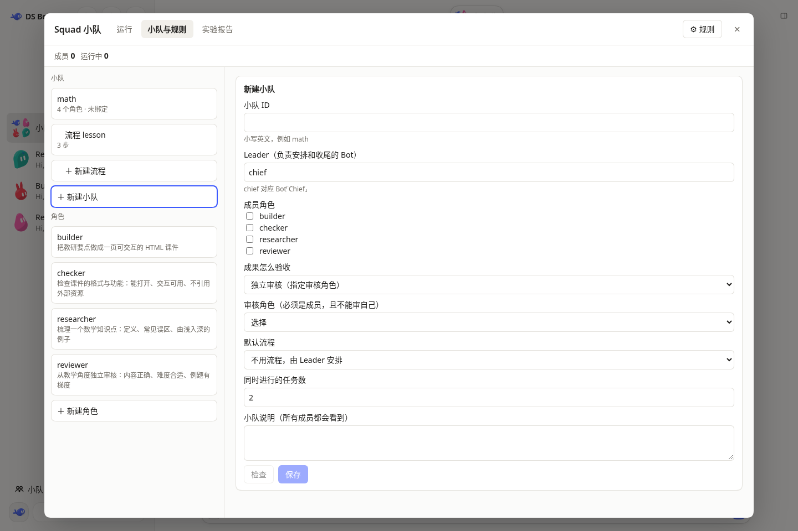

> 别人先改过同一个文件时，保存会提示重新读取，不会把别人的改动覆盖掉。

## 6. 开始一个小队任务

在「运行」标签点「＋ 开始一个小队任务」：选小队、选流程（不选就用默认流程，没有默认流程就由 Leader 安排）、写目标，点「开始」。

- 小队还没绑定到群时，会自动建一个「<小队> 小队」群，把 Leader 和各角色的 Bot 拉进去。
- 需要的 Bot 不存在时会自动创建，沿用项目里已配置的模型和思考档位。

开始后，任务树从 Leader 开始长出来（真实模型）：

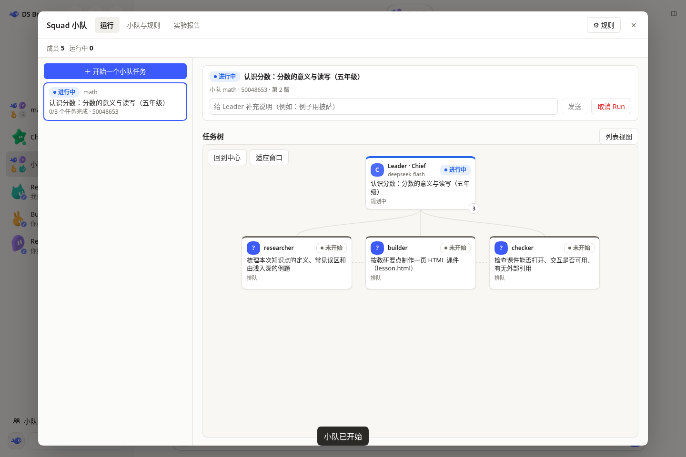

## 7. 看任务树和顶部汇总栏

**任务树**：根节点是 Leader 和这次的目标；Leader 每派一个任务，就从对应节点长出一个卡片，兄弟节点自动让位。审核是被审任务下面的子节点，返工挂在被退回的任务下面，重试挂在原任务下面。卡片上有成员头像、名字、模型、状态和一句话目标。

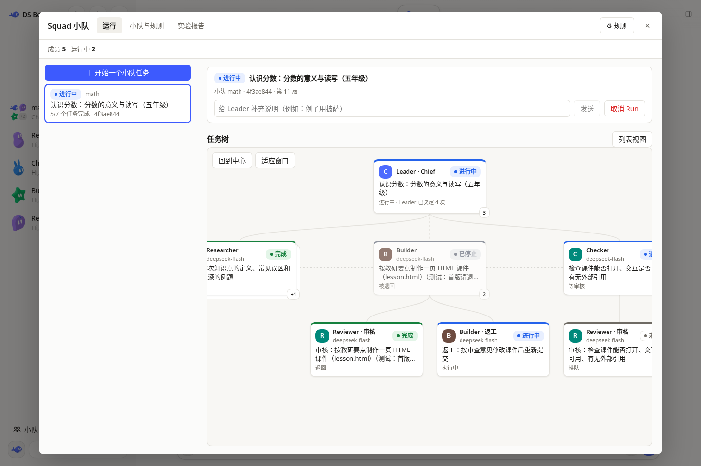

**五种状态**：

| 颜色 | 状态 | 意思 |
|---|---|---|
| 蓝 | 进行中 | 正在做，或在等审核。 |
| 绿 | 完成 | 做完并通过了。 |
| 橙 | 需要你处理 | 等你批准、验收、回答，或决定怎么办。 |
| 红 | 失败 | 没做成，卡片上写一句原因。 |
| 灰 | 已停止 | 被取消、被忽略，或已被返工替代。 |

还没开始的步骤是中性色。

**怎么看**：

- 拖动平移，Ctrl / ⌘ + 滚轮缩放；「回到中心」「适应窗口」。
- 卡片右下角的数字折叠或展开它下面的节点；做完的重试、返工链会自动叠成一叠。
- 同一个节点下并行的任务太多时，会自动换行排成几行。
- 点普通卡片，右侧弹出详情：完整目标、验收要求、结果和成果文件、审核意见、尝试历史、补充指导、技术细节。

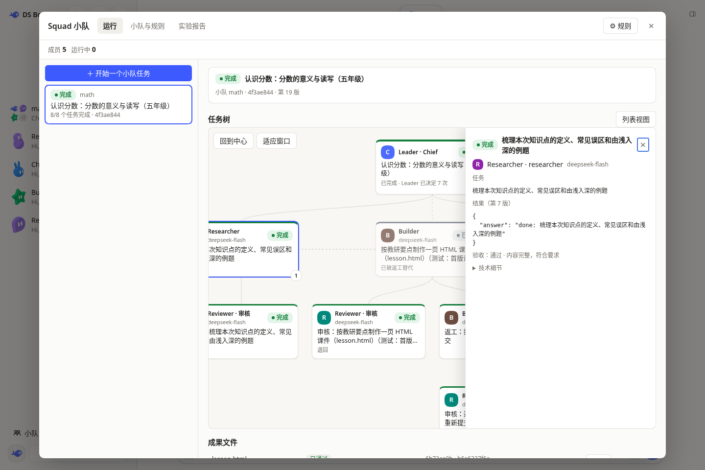

**顶部汇总栏**：成员数、运行中的任务数，以及「N 个需要你处理」「N 个失败」两个下拉。下拉按小队分组，点一项直接跳到那个卡片。新出现的待处理项只会让按钮闪一下，**不会自己跳走**，打断你正在看的东西。页面不显示花费和用时。

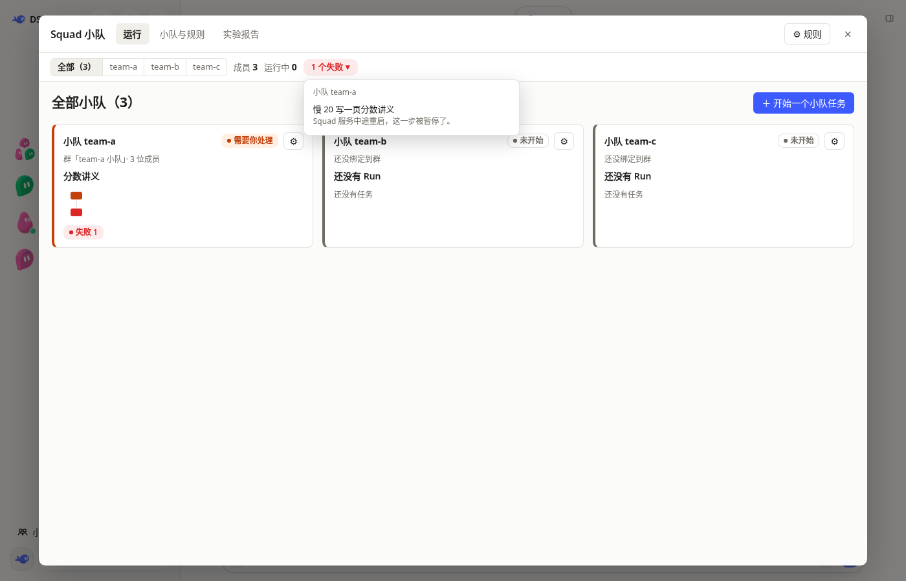

一个 Run 完成后的样子（真实模型，数学课件）：

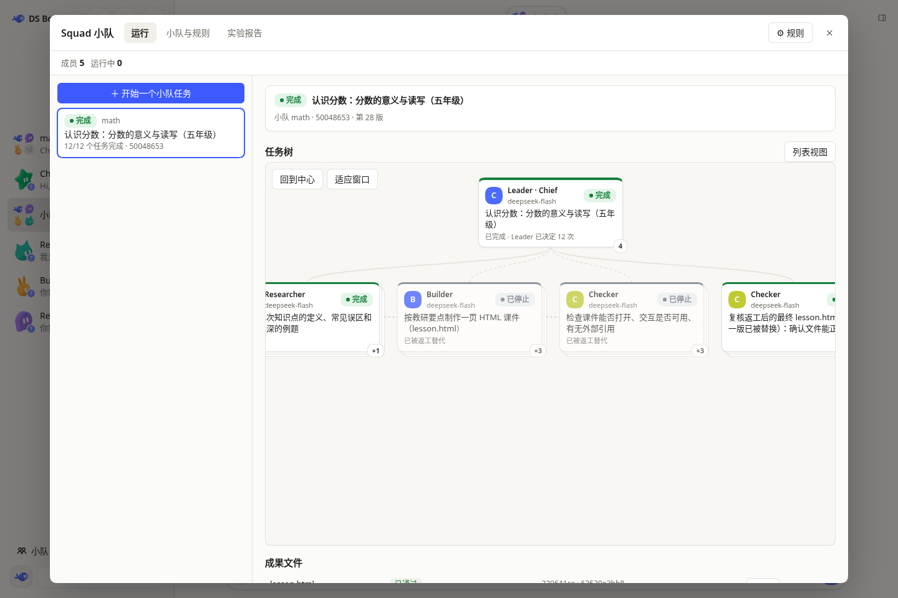

## 8. 处理「需要你处理」和失败的步骤

点橙色或红色卡片，旁边弹出处理框，只给当前情况需要的操作：

**失败的步骤**：一句话说明原因，只有「忽略」和「重试」两个主按钮，下面可以就这一步给 Leader 补充指导。

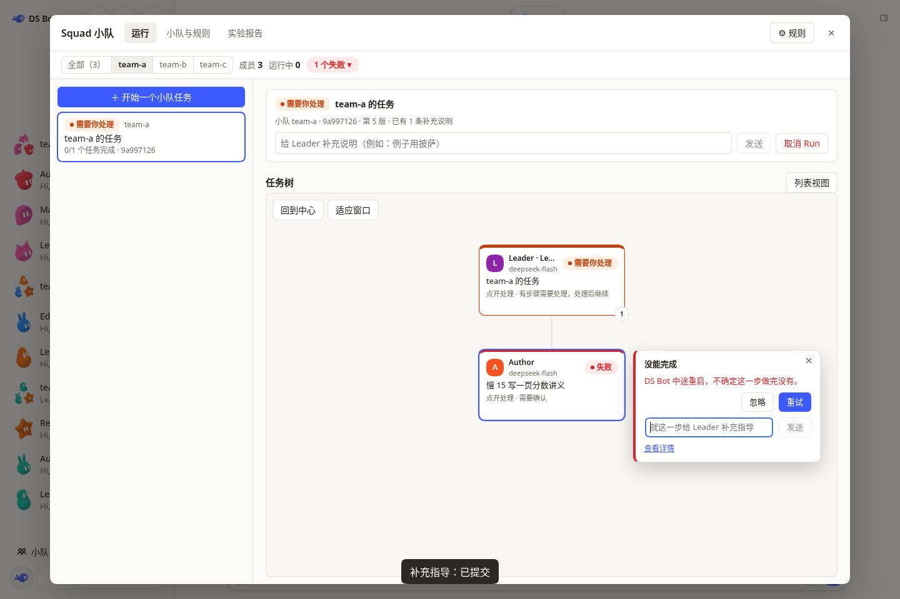

- **重试**：执行状态不确定时（比如 DS Bot 中途重启），会多一行「请确认上一次已经停下了」，确认后一键重新执行。

  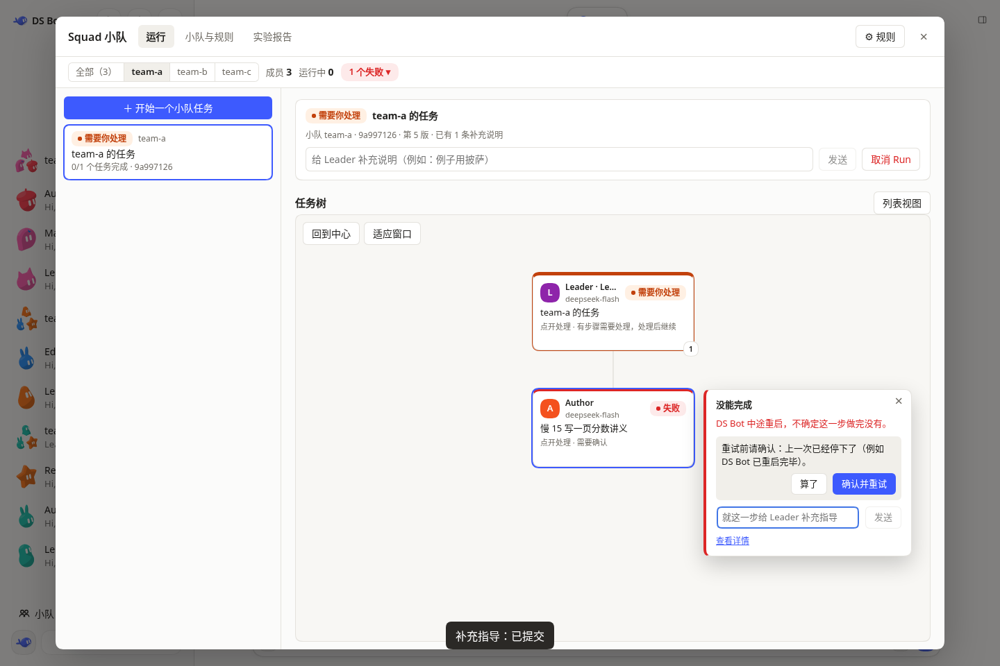

- **忽略**：先确认一次；这一步被取消，最终检查不再要求它，Run 继续往下走。

**等你验收**（验收方式是「人工验收」时）：看结果后点「通过」或「退回」。

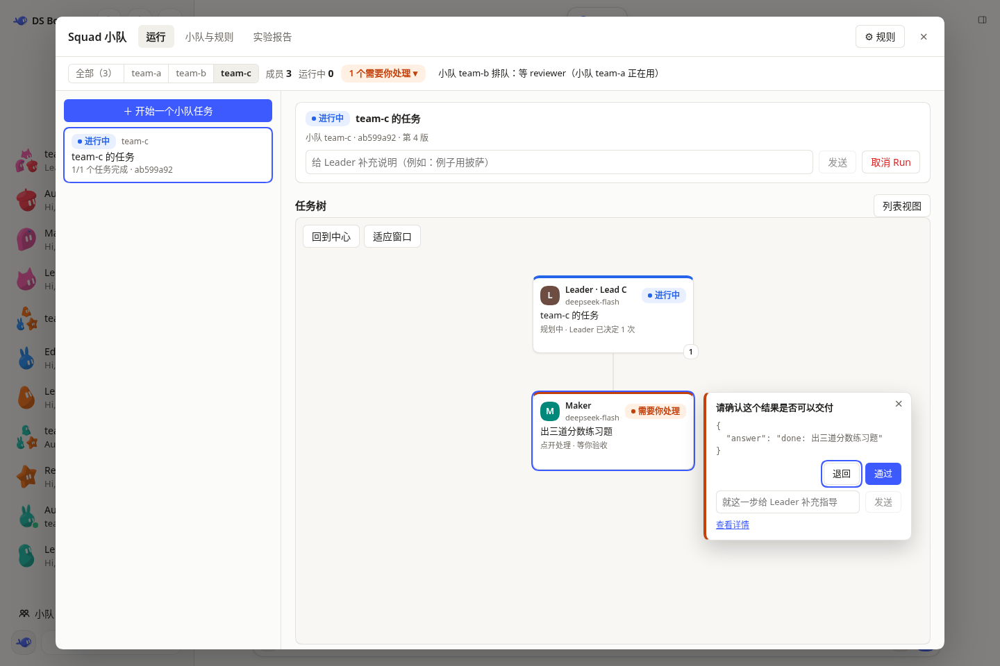

**最后检查没通过**：Leader 宣布完成时，最终检查发现还有问题（如没有任何通过的成果、某一步失败、还在等验收）。处理框写明原因，同样只有两个主按钮：「重试」让 Leader 重新检查、继续安排；「忽略」结束这个 Run，已有成果都保留（先确认一次）。也可以先补充指导再重试。

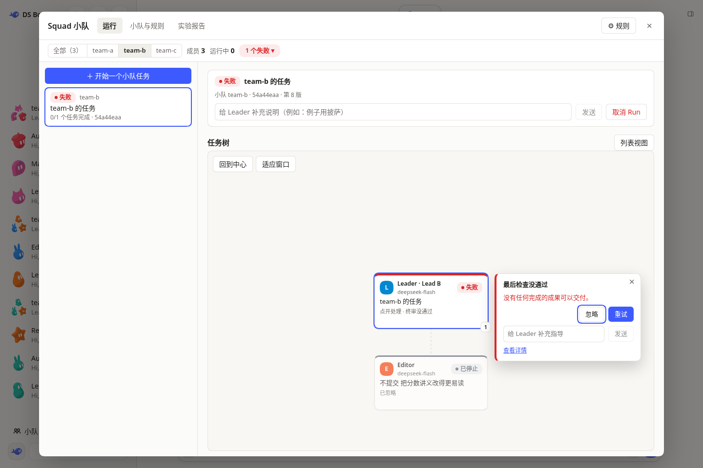

**等你批准工具**：受控的 Bot 要用需要批准的工具时，点「允许一次」或「拒绝」。

**群里的提醒**：不开 Squad 页面也不会错过。小队有事需要你处理或有步骤失败时，小队的 Leader 会在小队群里发一条提醒，列出是哪一步、为什么，每条后面有「打开 Squad 页面」链接，点开直接定位到那一步的处理框。提醒不会叫醒其他成员，同一件事只提醒一次。

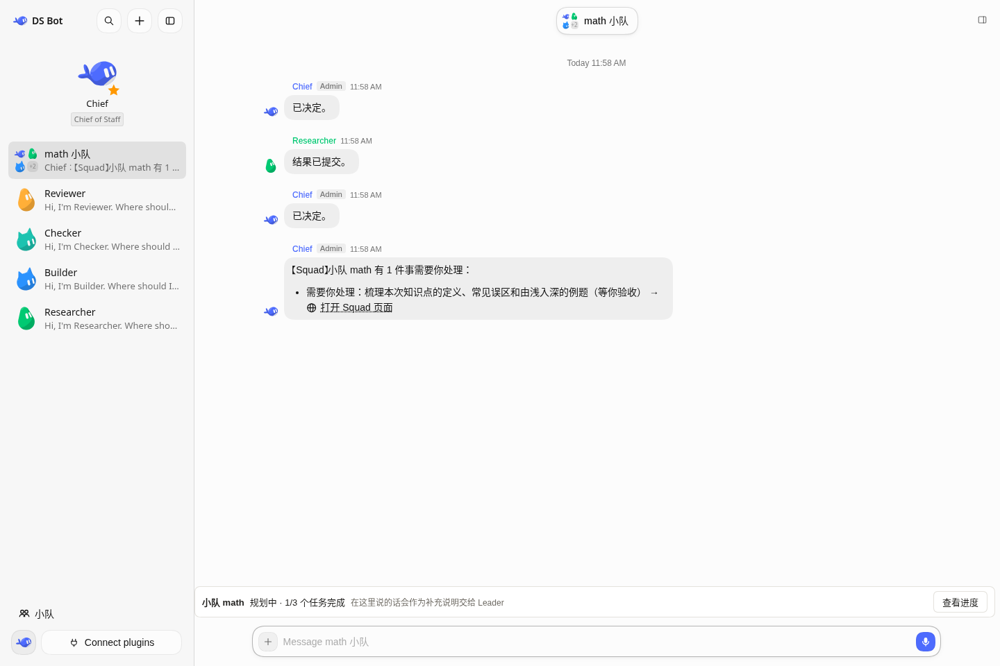

> 每个按钮都绑定卡片画出来时的版本。任务在你点之前已经变了（别人刚处理过、Bot 刚交了新版本），操作会被拒绝，等页面刷新后再看一眼再点，不会误操作到新版本上。

## 9. 返工和「基于旧版本」

**返工**：审核退回后，Leader 安排返工。返工是一个新节点，挂在被退回的版本下面；被退回的版本变灰，标「已被返工替代」，记录都保留。返工版本再审，通过为止。

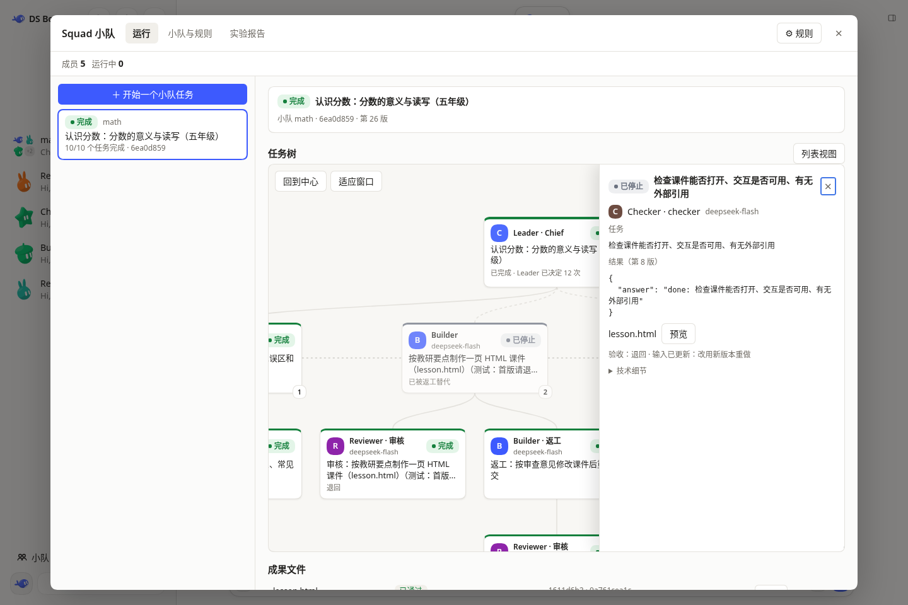

**基于旧版本**：如果某一步用的是一个后来被返工替换掉的版本（比如「检查」检查的是第一版课件），这一步会标「基于旧版本」，变成需要你处理：

- **用新版本重做**：在原节点下重做一次，改用新版本。
- **保留这一版**：确认旧版本的结果仍然可用。

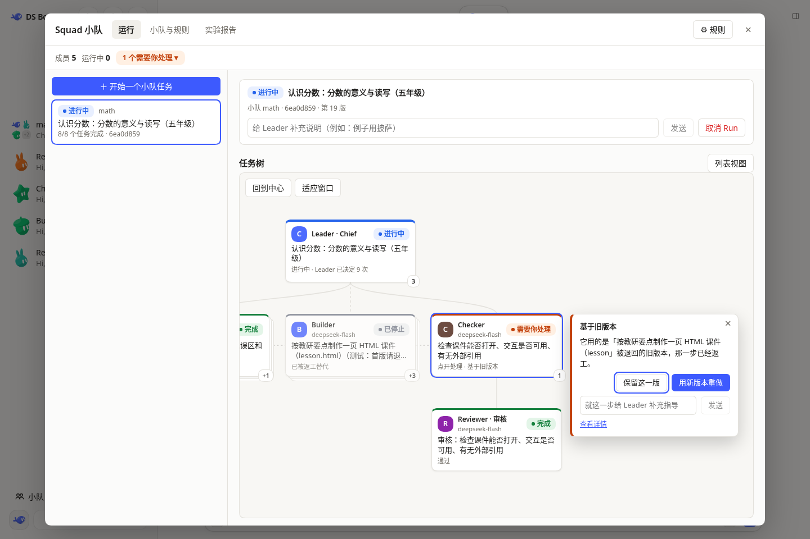

Leader 自己发现了也可以安排重做，效果和你点「用新版本重做」一样。真实模型测试里就是这样：Leader 发现「检查」是对第一版做的，自己安排对新版重新检查，最终检查通过。

## 10. 给 Leader 补充指导

Run 进行中，在 Run 标题下面的输入框写一句话发给 Leader（例如「例子请用切披萨来讲」）。Leader 下一次决定时会看到。也可以在某个卡片的处理框里「就这一步给 Leader 补充指导」，指导会带上这一步的名字。

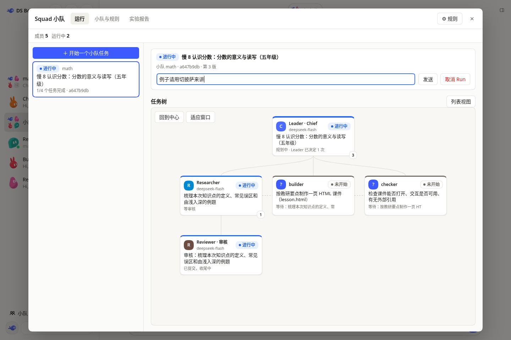

在小队的群里直接说话也行：Run 进行中，你在群里说的话会作为补充指导交给 Leader，同一句只记一次。只有你说的话算补充指导，Bot 在群里的发言不算。

## 11. 多个小队：总览和切换

有两个以上小队时，「运行」标签默认显示**全部小队总览**：每个小队一张卡片，有绑定的群、当前目标、缩略任务树、各状态的任务数。排队的小队写明在等谁（「等 reviewer，被小队 team-a 占用」），点后半句跳到那个小队。

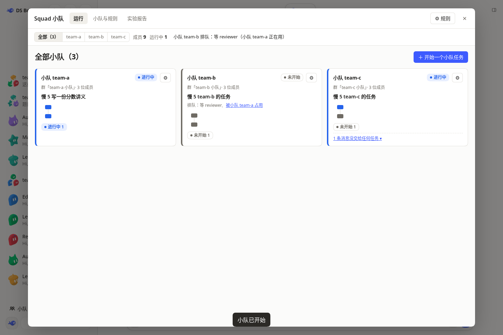

- 汇总栏左边的切换器在「全部」和各个小队之间切换，切换时每棵树的位置、缩放、折叠都保留。
- 几个小队共用一个角色时，同一个 Bot 在每个小队的群里各干各的，卡片上标「也在小队 X」；占用中的角色让后来的小队排队，先来先到。
- 你在看 A 的时候 B 开始了，汇总栏多一行「小队 B 已开始 →」，点了才切过去。

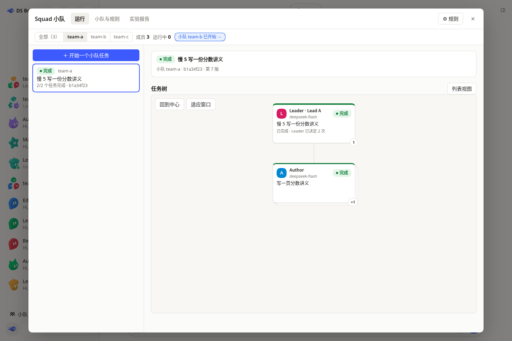

**没交给任何任务的消息**：没有 Run 进行时在小队群里说的话不会交给任何任务，卡片上显示「N 条消息没交给任何任务」。展开后可以「用这句话开始」一个 Run、「转为补充指导」（有 Run 进行时）或「忽略」。同一句话在各成员处的副本只算一条，处理一次全部处理。

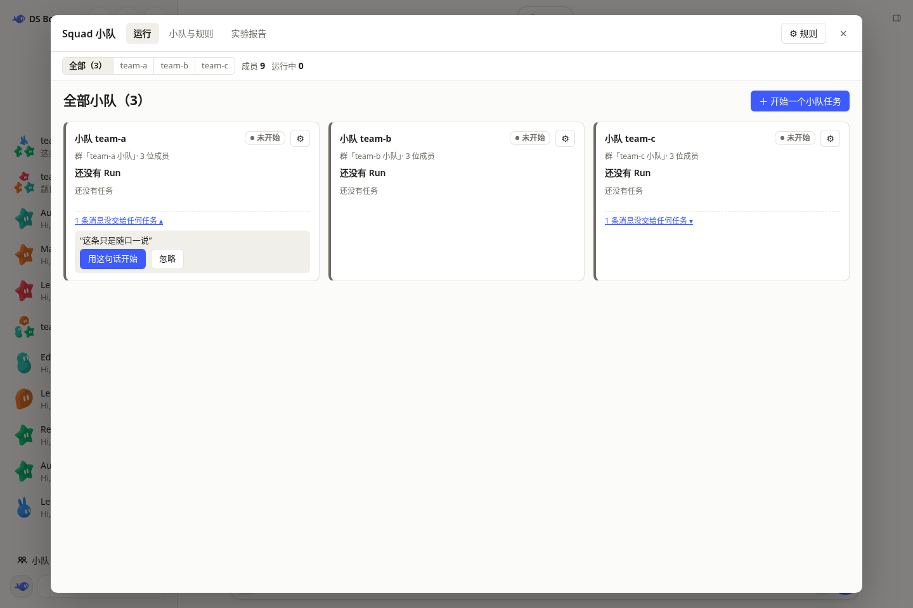

## 12. 查看成果和实验报告

**成果文件**：任务树下面列出每个成果文件的每个版本（已通过、待审核、已被返工取代）；在「列表视图」里也能看到。HTML 课件点「预览」，在隔离窗口里打开：用另一个主机名、沙箱运行、不能联网，读不到 DS Bot 的登录和数据（真实模型生成的课件）：

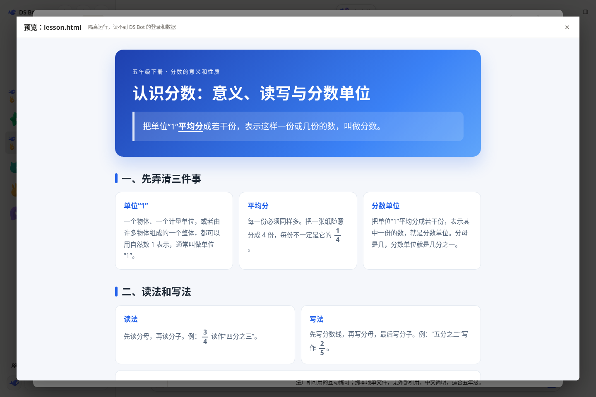

**实验报告**：「实验报告」标签显示对照实验的结果：同一个任务用四种做法各做一遍（S 单个强 Agent、A DS Bot 自由协作、B Squad 任务流程不审核、C Squad 流程加独立审核），比较成功与否、耗时、模型调用次数、Token（含记忆、摘要等辅助调用）、审核和返工次数。实验由开发者用命令运行（见 `dsh_squad/USAGE.md` 第 10 节），加 `--publish <项目>` 后报告出现在这里。

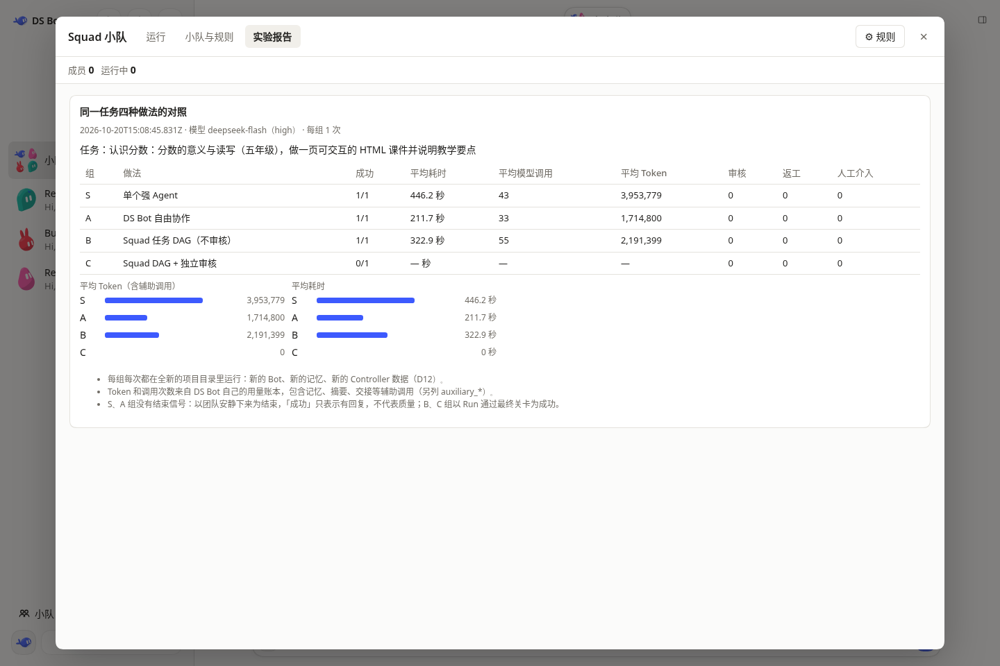

> 实验每组每次都在全新的项目目录里跑，互不继承 Bot、记忆和结果。一两次运行的数字只能说明「跑得通」，不能当作哪种做法更好的结论。

## 13. 键盘、深色模式、断线

- **键盘**：Tab / Shift+Tab 在页面内逐个经过卡片和按钮（不会跳到 DS Bot 页面上），跳到画面外的卡片时树会自动移过来；Enter 或空格打开；Esc 先关处理框或详情（焦点回到原卡片），再按一次关闭 Squad 页面。卡片对读屏软件读出成员、目标、状态和原因。

  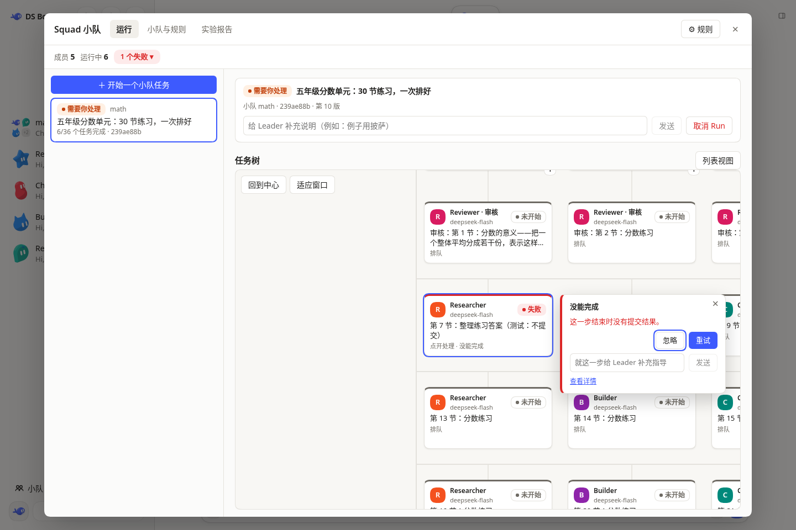

- **深色模式**：跟随 DS Bot 的主题设置自动切换（真实模型的数学课件）：

  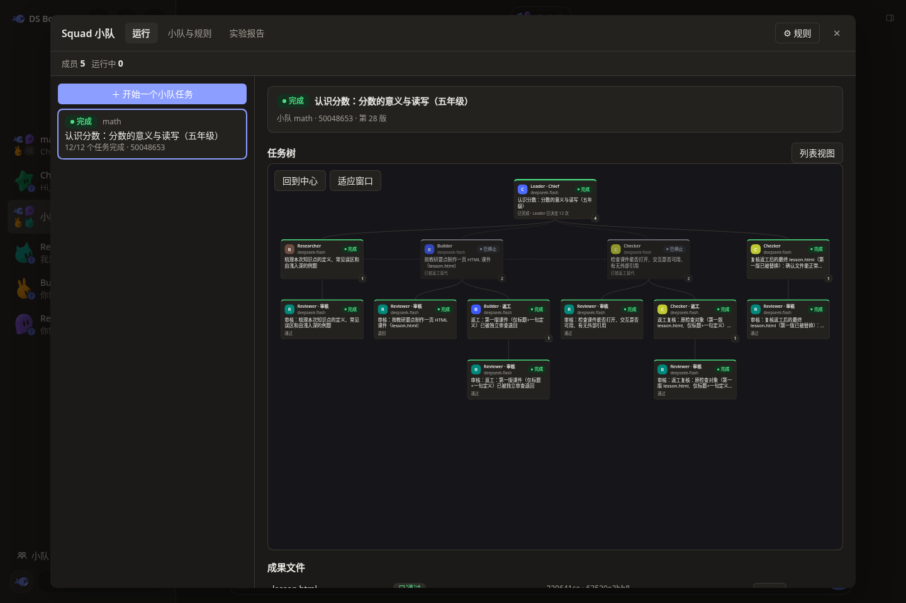

- **断线**：页面和 Controller 的连接断了，顶部出现黄条「连接中断，正在重新读取最新状态…」；连上后提示「已重新连上」，黄条自动消失。断线期间看到的状态可能不是最新的，等黄条消失后再操作。

  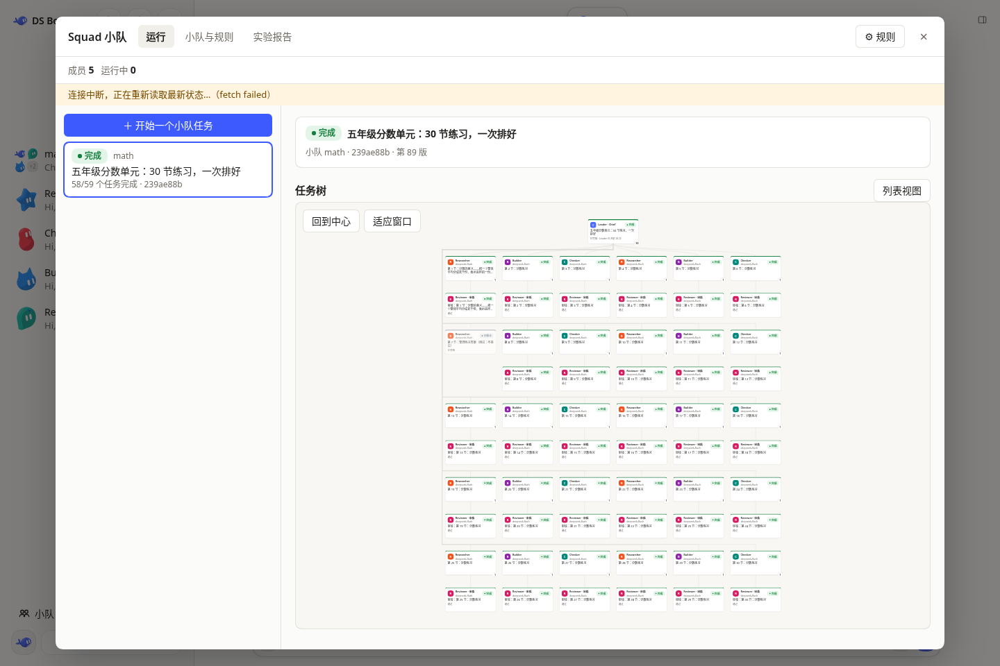

## 14. 常见问题和故障排查

| 现象 | 原因和处理 |
|---|---|
| 打开页面黄条写「还没连上 Squad Controller」 | Controller 没起来。在机器上运行 `dsh-squad status <项目>` 看进程，再 `dsh-squad up <项目>`。 |
| 黄条写「有 N 个成员没能接上 Controller」 | 黄条里写了原因。最常见的是改了小队说明或流程但版本没变：到「小队与规则」里保存一次，会自动升版本。 |
| 打开页面后 Chief 说「还没有模型」 | 还没给 DeepSeek key：在页面上点「Enter a DeepSeek API key」填入（见第 3 节），或用 `--mock` 先用模拟模型。 |
| 任务卡在「需要你处理」，写「基于旧版本」 | 见第 9 节：用新版本重做，或保留这一版。 |
| 任务失败，原因是「DS Bot 中途重启」或「很久没有回应」 | 执行结果不确定，系统不会自动重来。点「重试」，确认上一次已经停下后再执行。 |
| 取消了任务，但这个 Bot 迟迟不接新任务 | 取消不等于已停止：要等宿主报告这一轮真的结束才释放 Bot（通常几秒）。宿主离线时，在处理框里确认已停止。 |
| 点按钮提示「任务已经变了，请刷新」 | 卡片画出来之后任务有了新进展，页面刷新后再操作。这是防止误操作，不是故障。 |
| 小队一直「排队中」 | 它要用的角色正被另一个小队占用（卡片上写着被谁占用），对方结束后自动开始。 |
| Run 停在「失败」，写「最后检查没通过」 | 处理框写了原因：先处理卡住的那一步（重试、忽略、验收），再在 Run 上「重试」；不想继续就「忽略」结束 Run，成果保留。 |
| 群里说的话没有交给小队 | 没有 Run 进行时，群里的话不会交给任何任务，总览卡片上会显示，见第 11 节。 |
| 在受控任务里让 Bot 跑命令行没反应 | 正式任务里只允许规则里的工具（默认读文件、搜索），命令行、`run_code`、发消息给别的 Bot 都被拒绝，文件工具也只能访问项目目录和工作区。这是有意的限制。 |
| 想改 Bot 的模型或思考档位，提示「正在小队 Run 里工作」 | 小队有任务进行时，参与的 Bot 的模型和档位不能改，防止中途悄悄换模型。等 Run 结束再改即可，改名、改说明等其他修改不受影响。 |
| 机器休眠后很多任务变成「需要你处理」 | 短暂休眠后，系统会给正在做的任务留出一个周期等宿主恢复，通常能自己接着做。如果宿主在这期间没有恢复，系统按设计隔离这些执行：逐个点「重试」并确认已停止即可。 |

更多技术细节：[`dsh_squad/USAGE.md`](../../dsh_squad/USAGE.md)；验收记录：[`dsh_squad_case/ACCEPTANCE.md`](../../dsh_squad_case/ACCEPTANCE.md)。
