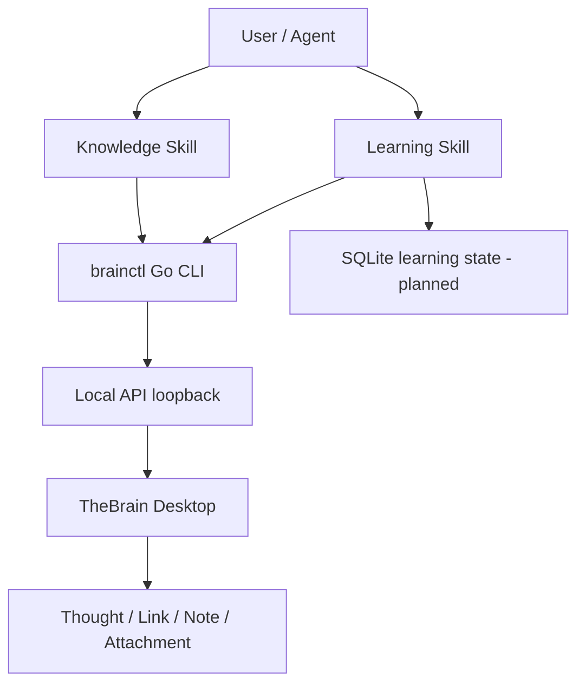

# 架构与契约

## A. 四层职责

- `TheBrain`：知识结构、连接与笔记是真源；禁止 SQLite 保存一套与 TheBrain 冲突的“另一份知识图谱”。
- `brainctl`：认证、参数规范化、重试、限流、审计、幂等保障以及防误写安全门。输出稳定 JSON，错误使用非零退出码。
- `Knowledge Skill`：语义判断、来源审查、知识重构与持续整理；仅通过 CLI 落地。
- `Learning Skill`：从已有 Thought/Graph 检索证据，推导问题和教学计划，通过用户回答更新学习状态。初始版本不修改知识真源。

## B. API 契约

- 源：`docs/api/docs.json`（48 paths / 58 operations / 11 modules / 29 schemas）。
- 本地 Origin 示例：`http://127.0.0.1:11522`；接口路径本身含 `/api/`。
- 认证：`Authorization: Bearer <LOCAL_API_KEY>`；在 Mac 的 `Settings > User > Local API Key` 获取。
- 所有 API 请求基于显式目标 Brain；`app state` 用于查看当前 UI，而不是写入时默认值来源。
- Graph 返回的邻域仅表示当前视图关系，不是全脑完整导出；搜索结果按范围和索引状态审查。
- 重试只读操作可适度重试；创建 Thought/Link/追加 Note **不得盲目自动重试**，必须先回读核验是否已成功。
- 规范中包含的 API 为源事实；如无法通过规范确认请求结构（如 JSON Patch、上传文件），须通过隔离 Brain 实测，不能硬编码猜测。

## C. P0 CLI 读能力

| 命令 | API | 权限 |
| --- | --- | --- |
| `brainctl doctor` | GET app/state, GET brains | Read |
| `brainctl app state` | GET /api/app/state | Read |
| `brainctl brain list` | GET /api/brains | Read |
| `brainctl brain get --brain-id UUID` | GET /api/brains/{id} | Read |
| `brainctl thought get --brain-id UUID --id UUID` | GET /api/thoughts/{brainId}/{thoughtId} | Read |
| `brainctl thought graph --brain-id UUID --id UUID` | GET /api/thoughts/{brainId}/{thoughtId}/graph | Read |
| `brainctl note get --brain-id UUID --id UUID` | GET /api/notes/{brainId}/{thoughtId} | Read |
| `brainctl search --brain-id UUID --query WORD` | GET /api/search/{brainId}?queryText=... | Read |

命令实现范围以 `cmd/brainctl` 实际源代码为准；文档不能提前把 P1 写入命令标为完成。

## D. P1 写能力（设计，未实现）

1. `plan`：读取目标 Thought、Notes、现有 Link、查重候选，计算预期变更与证据列表。
2. `diff`：明确新增/修改对象、原有内容、风险与 sourceThoughtId+relation 的方向。
3. `apply`：显式 `--brain-id` + `--apply` / 人工批准；批量写入先用测试 Brain。
4. `readback`：以实际返回 ID 读取，不依赖可能滞后的搜索索引。
5. `audit`：本地脱敏结构化日志；中断时记录部分成功；不能声称 API 支持事务。
6. `recover`：根据可重复查询的真实结果决定重试、补偿或人工干预，不做盲目重复创建。

危险操作（删除 Brain/Thought/Link、改变共享权限）不进入 P1 默认命令面，仅在专门测试仓/测试 Brain 明确启用。

## E. 数据模型与约束

- `Thought`：唯一 ID；名称可能不唯一。建议用 `Kind` 枚举的 Types（Project/Concept/Question/Evidence/Decision）作软语义分类；先探明 Types API 的实际创建能力。
- `Link`：父子层级 vs Jump 横向关联；规范内创建 Thought relation 1=child、2=parent、3=jump、4=sibling；LinkCreateModel 的枚举语义独立待测。
- `Note`：定义、来源、假设/事实等级、反例、关系依据、最后验证时间；默认不覆盖用户内容。
- `Attachment`：源文件/URL 不自动粘贴私人副本到公有仓库。
- `LearningState`（SQLite，后续）：`{brainId,thoughtId,learnerId,skillId,attempt,correct,confidence,nextReviewAt,sourceVersion}` 作为候选 schema；按数据最小化原则迭代。

## F. Agent Skill 对 CLI 的调用规则

两个 Skill 每个步骤必须声明：
- 输入：用户目标、明确 Brain ID、候选 Thought ID/检索词、证据范围。
- 预条件：本机服务连通、Key 有效；写入还需测试 Brain + 审核。
- 调用：精确 CLI 命令，日志不含 token/Note 私密全文。
- 验证：以独立 readback / 用户问答确认结果，保留失败或不确定证据。
- 输出：知识结构变化、来源与状态；学习 Skill 额外给出掌握评估与下一步复习建议。

## G. 运行边界

只支持本机回环地址（`localhost` / `127.0.0.1` / `::1`），不把 Local API 开放到公网。远程 AI 不可以直接访问用户 Mac 的 localhost；必须由用户本机运行 CLI，未来若要远程 Agent 调用再另设计具备鉴权、最小权限、授权审计的本地执行代理。
